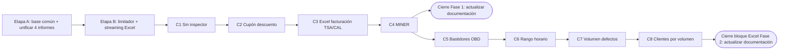

# Plan de Siguientes Pasos — Unificación de Informes y Nuevos Informes (`frmCriterios`)

> **Estado:** Propuesta pendiente de aprobación · **Fecha:** 02/11/2026
> **Alcance:** Cierre de Fase 1 y bloque de informes Excel de la Fase 2 (sin Localización ni CRM).

## Decisiones ya tomadas

| Tema | Decisión |
| :--- | :--- |
| Impresión | Se mantienen los **modales HTML estilo Crystal Reports**. Imprimen bien, así que no se cambia a QuestPDF. |
| Tests | Se harán más adelante (están previstos). No forman parte de este plan. |
| Documentación técnica | Se actualiza **al cerrar cada fase**. Por informe solo se añade la entrada en `CHANGELOG.md`. |
| Unificación | Todos los informes (los existentes y los nuevos) deben tener **las mismas mejoras**, recogidas en el *Estándar de Informe* (sección 1). |

---

## 1. Estándar de Informe (lo que debe cumplir todo informe)

Son las mejoras que hemos ido haciendo informe a informe. A partir de ahora pasan a ser obligatorias y salen de componentes compartidos, no de copiar código.

**Filtros y búsqueda**
1. Por defecto, mes en curso (del día 1 a hoy) y distintivo `ℹ️ Rango máx. 1 año`.
2. Los filtros rápidos (Fase, Sociedad, Estaciones) **buscan al momento**, con un debounce de 250 ms y cancelando la petición anterior.
3. Los selectores de fecha **no buscan**: hay que pulsar *Consultar* o Enter.
4. Si el rango es inválido (más de 366 días o fin anterior a inicio): `TsAlert` visible con el botón *Ajustar a 1 año*, **se vacían el grid y los KPIs** y la tabla muestra un mensaje explicativo.
5. Solo se muestran las estaciones que el usuario tiene permitidas.

**Cabecera y acciones**
6. Título sin la etiqueta "Oficial", miga de pan y botón *Volver a Informes*.
7. Los botones *Imprimir* y *Exportar a Excel* quedan **desactivados si no hay datos**.
8. Al consultar y al exportar aparece el modal bloqueante (`BlockingLoadingModal`).

**Gráficos y KPIs**
9. Selector de gráfico a la derecha, con botonera segmentada.
10. Los formateadores usan las unidades del informe (nada de "€" donde no corresponde) y los tooltips usan `AppTooltip`.

**Grid**
11. Ordenación por columna **sobre todos los datos antes de paginar**, volviendo a la página 1.
12. Paginación de 50/100/200/500 filas, buscador y contador "Mostrando X de Y **registros**".
13. Anchos de columna fijos (`table-layout: fixed` + `colgroup`), texto cortado con `…` y tooltip, sin columnas que se solapen y sin scroll horizontal que aparezca y desaparezca.
14. Filas alternas (`#ffffff`/`#f8fafc`) con **hover** `#edf5ff`.

**Backend**
15. Validación de fechas en servidor (máx. 366 días), SQL con *bind variables* y plan de ejecución revisado en Oracle.
16. Cancelación limpia (sin que salte ORA-12570 en el debugger), reintento ante socket caído y `CommandTimeout`.
17. El Excel replica la estructura del escritorio: columnas, nombres de las hojas y una hoja por estación cuando el original lo hace así.

---

## 2. Etapa A — Base común y unificación de los 4 informes existentes

**Objetivo:** que el Estándar de Informe salga de componentes compartidos, para que los informes nuevos lo tengan sin hacer nada.

| # | Pieza | Qué incluye |
| :-: | :--- | :--- |
| A1 | `useReportFilters` (hook) | Fechas por defecto, validación + alerta + *Ajustar a 1 año* + vaciado de datos, debounce, `AbortController` y la regla de que las fechas no buscan (puntos 1–5) |
| A2 | `useReportTable` (hook) | Búsqueda, ordenación global, paginación y vuelta a la página 1 (puntos 11–12) |
| A3 | `ReportPageHeader`, `ReportDateRangeAlert`, `ReportChartModeSelector`, `ReportDataTable` | Puntos 6–10 y 13–14 |
| A4 | Backend: `ReportDateRangeValidator` y helper `OracleReportExecutor` | Une la validación y los 4 `EjecutarQueryAsync` que hoy están duplicados (reintento, ORA-12570, timeout) |
| A5 | Migración | **Defectos OBD → Nº Inspecciones → Duración Promedio → Facturación**, revisando cada uno contra el Estándar |

> [!IMPORTANT]
> Criterio de cierre de A: los 4 informes se comportan igual en los 17 puntos y el aspecto de cada pantalla no cambia (salvo para corregir lo que no cumpla el Estándar).

---

## 3. Etapa B — Exportaciones sin saturar el servidor

**Situación actual (comprobada en el código):** las exportaciones **no van en streaming**. El flujo es: lector de Oracle → lista completa en memoria → copia a DTOs → libro ClosedXML en memoria → `byte[]` → descarga. ClosedXML gasta bastante memoria por celda, así que varias exportaciones grandes a la vez (por ejemplo, Defectos OBD de un año) pueden llenar la memoria del servidor. Con los informes agregados (unas 30 filas por estación) no hay ningún riesgo.

| # | Medida | Efecto | Esfuerzo |
| :-: | :--- | :--- | :-: |
| B1 | **Limitador de concurrencia** (`RateLimiter` de ASP.NET Core, `ConcurrencyLimiter`) en todos los `/exportar-excel`: p. ej. 3 a la vez y 10 en cola. Si se llena, devuelve 429 y el modal dice *"Hay otras exportaciones en curso, inténtelo en unos segundos"* | Pone un tope al consumo total por mucho que pidan los usuarios | Pequeño |
| B2 | **Streaming de principio a fin con SpreadCheetah** en los informes de detalle: el lector de Oracle escribe directamente en `Response.Body`, sin lista ni `byte[]`. Para tener una hoja por estación, se ordena por `CODESTACION` y se abre hoja nueva al cambiar de estación | La memoria queda constante sea cual sea el número de filas | Mediano |
| B3 | `FetchSize` de Oracle ajustado y cancelación si el usuario cierra o aborta | Menos idas y vueltas a la BD y sin consultas huérfanas | Pequeño |
| B4 | **Medir la consulta del grid** (JSON con todas las filas) con Defectos OBD de 1 año: tamaño y tiempo | Datos para decidir B5 | Pequeño |
| B5 | *(Según B4)* Paginación y ordenación **en servidor** para los informes de detalle, con los KPIs calculados en SQL | Pantalla ligera aunque el volumen sea muy grande | Mediano |

> [!NOTE]
> SpreadCheetah no ajusta el ancho de columnas automáticamente: se ponen anchos fijos por columna. ClosedXML se queda **solo en los Excel agregados o con formato complejo** (p. ej. la comparativa de facturación).

---

## 4. Etapa C — Nuevos informes (orden propuesto)

| Orden | Informe (menú) | Legacy (`frmCriterios.vb`) | Tipo / volumen | Filtros | Particularidades |
| :-: | :--- | :--- | :--- | :--- | :--- |
| **C1** | Inspecciones sin inspector | `Cargar_Dataset_Exportacion_InspeccionesSinInspector` | Detalle (pocas filas) | Fechas + Estaciones | Inspecciones sin `CODINSPECTOR` ni `CODINSPECTOR1..3`. Es el más sencillo: **sirve para probar la base común** |
| **C2** | Inspecciones con cupón descuento | `..._InspeccionesCuponDescuento` | Detalle (medio) | Fechas + Estaciones | JOIN con `CUPONES`. Cálculo de *Importe abonado* (tarifa + tasas + IVA − descuento). KPIs de importe y descuento |
| **C3** | Excel facturación de inspecciones (TSA/CAL) | `frmCriteriosExcel.vb` | Agregado | Fechas + Sociedad | **Cierra la Fase 1**. Corrige el bug documentado de *arrastre de importes*. ClosedXML |
| **C4** | Estadística MINER — Datos globales | `ExportacionEstadistica_MINER_Global` + `Cargar_Datos_Estadistica_Excel_*` | Agregado (3 consultas) | Fechas + Estaciones | Defectos por bloque y gravedad, y primeras/segundas inspecciones FAV/DESFAV (solo periódicas). **Cierra la Fase 1** |
| **C5** | Bastidores OBD no coincidentes | `MostrarInformeBastidoresOBDNoCoincidentes` | Detalle | Fechas + Estaciones | **Cierra el bloque OBD**. En el escritorio ya tiene grid en pantalla además del Excel |
| **C6** | Inspecciones por rango horario | `..._InspRangoHorario` | Agregado (PIVOT día × hora 06–21) | Fechas + Fase | Gráfico tipo **mapa de calor** día × hora. El escritorio **no filtra por estación**: hay que decidirlo (ver sección 6) |
| **C7** | Volumen de defectos detectados | `..._VolumenDefectos` | Agregado | Fechas | Agrupa por grupo de categoría (M1, M2/M3…), bloque, defecto y subdefecto. Solo periódicas |
| **C8** | Clientes por volumen de inspecciones | `..._ClientesVolumen` | Agregado (puede tener muchas filas) | Fechas + Fase + Estaciones + Tipo vehículo + Proyecto comercial + Mínimo de inspecciones | **Datos personales** (nombre, domicilio, teléfonos): exportación **auditada** en `LOG_AUDITORIA_WEB` y streaming |

**Fuera de este plan:** *SMSs/EMAILs enviados y totales* (pasa a la Fase 4 CRM) y los 4 formularios de **Localización** (segunda parte de la Fase 2, con su propio plan).

> [!TIP]
> B1 (limitador) es pequeño y se puede hacer al principio, en paralelo con A. B2 (streaming) debe estar listo **antes de C2**, que es el primer informe nuevo de detalle con volumen.

---

## 5. Criterio de "terminado" para cada informe

- [ ] Cumple los 17 puntos del Estándar de Informe (sección 1).
- [ ] El Excel coincide con el de escritorio en columnas, orden, nombres de hojas y tipos de dato.
- [ ] Mismas cifras que el escritorio para un mismo rango y estación (cotejo manual de al menos un mes).
- [ ] SQL con *bind variables*, plan revisado y tiempos medidos para 1 mes y para 1 año.
- [ ] Registrado en `IMPLEMENTED_SCREENS`, en el catálogo de informes y con persistencia F5.
- [ ] Compila frontend (`npm run build`) y backend (`dotnet build`).
- [ ] Entrada en `CHANGELOG.md`.

---

## 6. Decisiones pendientes

1. **B5 — paginación en servidor:** ¿esperamos a medir (B4) o la aplicamos ya en los informes de detalle?
2. **C6 — rango horario:** el escritorio no filtra por estación. ¿Se replica tal cual (toda la red) o se limita a las estaciones permitidas del usuario, como el resto de informes? *Recomendación: limitar por permisos.*
3. **B1 — límite de concurrencia:** ¿3 exportaciones a la vez para toda la aplicación es razonable para el número de usuarios previsto?
