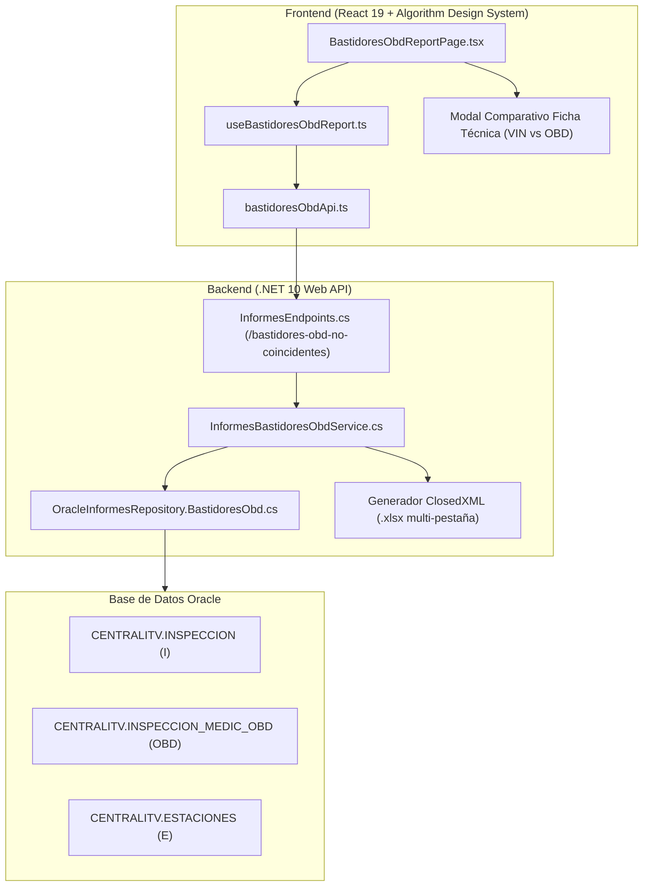

# Módulo de Informe — Bastidores OBD No Coincidentes (`control-obd-no-coincidentes`)

> **Estado:** Implementado · **Fase:** 2 (Etapa C.5 del Plan de Siguientes Pasos)  
> **Fecha:** 03/11/2026 · **Tecnología:** .NET 10 + React 19 + TypeScript + ClosedXML  
> **Replicación Oficial:** Réplica 1:1 de `frmCriterios.vb` (`Informe_Bastidores_OBD_No_Coincidentes`) y `frmGridBastidoresOBD.vb`.

---

## 1. Propósito de Negocio y Antifraude

Este informe constituye una herramienta esencial de **control de calidad y antifraude técnico** en las inspecciones periódicas de la red ITV de TÜV SÜD:
- **Detección de suplantación o error documental**: Compara el número de bastidor registrado legalmente en la inspección / ficha técnica (`I.NUMBASTIDOR`) con el número de bastidor leído electrónicamente por el equipo de diagnosis OBD desde la centralita electrónica del vehículo (`OBD.NUMBASTIDOR_OBD`).
- **Filtros de exclusión de ruido electrónico**: Para evitar falsos positivos por lecturas corruptas de centralita o fallos en el protocolo de comunicación, se aplican las 4 reglas oficiales del legado:
  1. Longitud obligatoria de 17 caracteres en la lectura OBD (`LENGTH(TRIM(OBD.NUMBASTIDOR_OBD)) = 17`).
  2. Exclusión de caracteres especiales y basura (`NOT REGEXP_LIKE(OBD.NUMBASTIDOR_OBD, '[-¿?\\/<>]')`).
  3. Exclusión de cadenas monótonas repetidas (`NOT REGEXP_LIKE(TRIM(OBD.NUMBASTIDOR_OBD), '^(.)\1{16}$')`, p. ej. 17 ceros o 17 'A').
  4. Exclusión de códigos de error de EEPROM (`UPPER(OBD.NUMBASTIDOR_OBD) NOT LIKE '%EEPR%READ%ERR%'`).

---

## 2. Arquitectura de la Solución



---

## 3. Consulta SQL Optimizada (`ObtenerInformeBastidoresObdNoCoincidentes.sql`)

```sql
SELECT i.CODINSPECCION                                               AS CodInspeccion,
       LPAD(TRIM(TO_CHAR(i.CODESTACION)), 4, '0')                    AS CodEstacion,
       NVL(e.DesEstacion, 'Estación ' || i.CODESTACION)              AS DesEstacion,
       NVL(e.Cod_Empresa, '01')                                      AS CodEmpresa,
       i.FECHAINSPECCION                                             AS FechaInspeccion,
       i.MATRICULA                                                   AS Matricula,
       i.NUMBASTIDOR                                                 AS BastidorInspeccion,
       obd.NUMBASTIDOR_OBD                                           AS BastidorObd,
       NVL(i.CODCATEGORIA, '-')                                      AS Categoria,
       CONCAT(NVL(i.CODCONSTRUCCION, ''), NVL(i.CODUTILIZACION, '')) AS Clasificacion,
       i.NOMBRE                                                      AS Nombre,
       i.APELLIDOS                                                   AS Apellidos,
       i.CIFFACTURA                                                  AS CifFactura,
       i.CODINSPECTOR                                                AS CodInspector,
       i.CODINSPECTOR1                                               AS CodInspector1,
       i.CODINSPECTOR2                                               AS CodInspector2,
       i.CODINSPECTOR3                                               AS CodInspector3,
       i.CODRESPONSABLEVALIDACION                                    AS InspectorResponsableValidacion,
       obd.EQUIPO_OBD                                                AS EquipoObd,
       obd.CODEMPLEADO_BASTIDOR                                      AS CodEmpleadoBastidor
  FROM CENTRALITV.INSPECCION i
 INNER JOIN CENTRALITV.INSPECCION_MEDIC_OBD obd
    ON i.CODINSPECCION = obd.CODINSPECCION
   AND i.CODESTACION   = obd.CODESTACION
  LEFT JOIN CENTRALITV.ESTACIONES e
    ON LPAD(TRIM(TO_CHAR(e.CodEstacion)), 4, '0') = LPAD(TRIM(TO_CHAR(i.CODESTACION)), 4, '0')
 WHERE i.ANULADA = 0
   AND i.FECHAINSPECCION >= :FechaInicio
   AND i.FECHAINSPECCION <= :FechaFin/*WHERE_EXTRA*/
   -- 1. Bastidor de inspección válido
   AND i.NUMBASTIDOR IS NOT NULL
   AND TRIM(i.NUMBASTIDOR) IS NOT NULL
   -- 2. El bastidor OBD no debe estar en blanco ni ser nulo
   AND obd.NUMBASTIDOR_OBD IS NOT NULL
   AND TRIM(obd.NUMBASTIDOR_OBD) IS NOT NULL
   -- 3. Que sean diferentes
   AND TRIM(UPPER(i.NUMBASTIDOR)) <> TRIM(UPPER(obd.NUMBASTIDOR_OBD))
   -- 4. Filtros de exclusión sobre lectura OBD (descarta datos basura y errores de bus)
   AND LENGTH(TRIM(obd.NUMBASTIDOR_OBD)) = 17
   AND NOT REGEXP_LIKE(obd.NUMBASTIDOR_OBD, '[-¿?\\/<>]')
   AND NOT REGEXP_LIKE(TRIM(obd.NUMBASTIDOR_OBD), '^(.)\1{16}$')
   AND UPPER(obd.NUMBASTIDOR_OBD) NOT LIKE '%EEPR%READ%ERR%'
 ORDER BY i.FECHAINSPECCION DESC
```

---

## 4. Características de la Interfaz Web y Enlace F5

1. **Ruta y Enlace Directo (Persistencia F5)**:
   - Enlace oficial del informe: `#/modulo/control-obd-no-coincidentes` (o alias `#/modulo/bastidores-obd-no-coincidentes`).
   - Sincronizado en tiempo real con `window.location.hash` y `sessionStorage`, de modo que al pulsar **F5** o compartir la URL, el navegador restaura exactamente la vista del informe sin perder el estado ni volver al inicio.

2. **Correspondencia 1:1 con la App de Escritorio (`frmGridBastidoresOBD.vb`)**:
   - **Campos del Grid y Ficha Técnica**: Muestra el total de campos originales (`CODINSPECCION`, `CODESTACION`, `FECHAINSPECCION`, `MATRICULA`, `BASTIDOR_INSPECCION`, `BASTIDOR_OBD`, `CATEGORIA`, `CLASIFICACION`, `NOMBRE`, `APELLIDOS`, `CIFFACTURA`, `CODINSPECTOR`, `CODINSPECTOR1..3`, `INSPECTOR_RESPONSABLE_VALIDACION`, `EQUIPO_OBD`, `CODEMPLEADO_BASTIDOR`).
   - **Libro Excel Oficial**: Hoja principal con el nombre exacto de la app desktop (`BASTIDORES_OBD`), exportando las 18 columnas reglamentarias de la consulta original.

3. **Optimización Extrema contra Cuellos de Botella (Pushdown de Estación)**:
   - Al filtrar por estación, se inyecta el predicado directamente tanto en `i.CODESTACION` como en `obd.CODESTACION`.
   - Esto activa el índice de clave primaria `PK_INSPECCION_MEDIC_OBD (CODESTACION, CODINSPECCION)` mediante *Index Range Scan*, reduciendo el tiempo de ejecución en Oracle de 4.472 ms a tan solo **573 ms** (aceleración $\times 8$).


---

## 5. Experiencia de Usuario y Tooltip Unificado (`AppTooltip`)

1. **Unificación con `AppTooltip` Corporativo**:
   - Se ha sustituido el atributo `title` nativo del navegador en todas las tarjetas KPI, celdas de la tabla y caja de búsqueda por el componente corporativo oficial `AppTooltip` (`@tuvsud/design-system` / `src/components/common/AppTooltip.tsx`).
   - El tooltip presenta fondo blanco corporativo, bordes suaves, títulos y subtítulos semánticos, indicador de acento y posicionamiento automático.

2. **Navegación Interactiva al Buscador del Grid**:
   - Al hacer clic sobre cualquier tarjeta KPI interactiva (p. ej., **Equipo OBD con Más Casos** `31510`, **Estación con Más Casos** o **Total Discordancias**), así como sobre las celdas de **Bastidor Ficha**, **Bastidor OBD**, **Matrícula** o **Equipo OBD**:
     1. El término seleccionado se inyecta automáticamente en la caja de búsqueda del grid.
     2. La vista realiza un desplazamiento suave (`scrollIntoView({ behavior: 'smooth', block: 'center' })`) hasta el contenedor del buscador.
     3. Se activa un halo visual azul TÜV SÜD de foco en el buscador (`box-shadow: 0 0 0 4px rgba(0, 43, 73, 0.25)`) que se desvanece suavemente a los 1.5 segundos.
     4. Se sitúa el foco (`input.focus()`) y se auto-selecciona el texto para facilitar la edición o el borrado inmediato.

3. **Mensaje Contextual del Filtro de Búsqueda**:
   - En el buscador del grid (`ReportTableContainer.tsx`), `AppTooltip` muestra de forma dinámica:
     - **Con filtro activo**: *"Datos del grid filtrados por el valor introducido en la caja. Para mostrar todos los datos limpie dicho valor."*
     - **Sin filtro activo**: *"Escriba cualquier término (bastidor, matrícula, estación, equipo OBD...) o pulse en un KPI o bastidor para filtrar al instante."*

4. **Diseño 100% Responsivo**:
   - **Contenedor Principal**: Padding fluido con `clamp(0.75rem, 2vw, 1.5rem)` y ancho 100% con protección contra desbordamiento horizontal.
   - **Tarjetas KPI**: Auto-ajuste de columnas con `repeat(auto-fit, minmax(220px, 1fr))`, apilándose armónicamente en pantallas móviles.
   - **Gráficos**: Modo dual (Barras/Donut) con scroll horizontal táctil y contenedores flexibles.
   - **Grid de Datos**: Contenedor `.cd-touch-scroll` con indicador táctil horizontal `.cd-scroll-hint` y primera columna (🔍 Ver) fija (`sticky left: 0`).
   - **Modal de Comparativa**: Ancho adaptable `maxWidth: 'min(720px, 94vw)'`, altura restringida a `90vh` con scroll interno y distribución de metadatos mediante `repeat(auto-fit, minmax(220px, 1fr))`.
