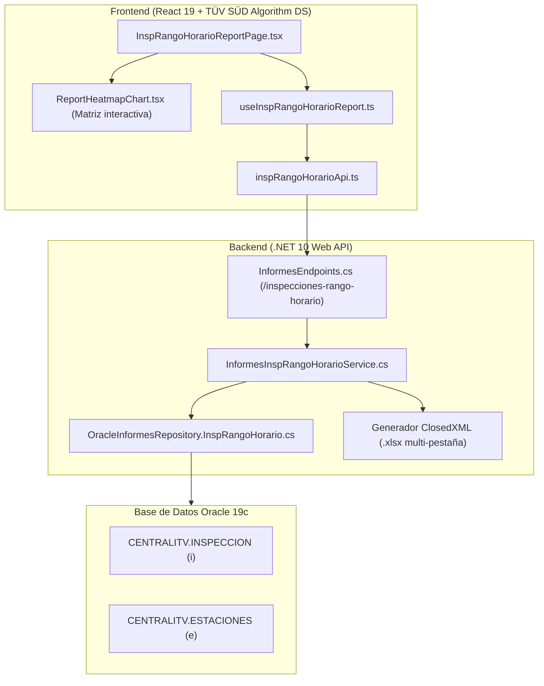

# Módulo de Informe — Inspecciones por Rango Horario (`inspecciones-rango-horario`)

> **Estado:** Implementado · **Fase:** 2 (Etapa C.6 del Plan de Siguientes Pasos)  
> **Fecha:** 03/11/2026 · **Tecnología:** .NET 10 + React 19 + TypeScript + ClosedXML + Ollama Qwen Coder  
> **Replicación Oficial:** Réplica 1:1 de `frmCriterios.vb` (`ExportacionInspeccionesRangoHorario` / `Cargar_Dataset_Exportacion_InspRangoHorario`).

---

## 1. Propósito de Negocio y Utilidad Analítica

Este informe proporciona una visión global y detallada sobre la **distribución temporal de la carga de trabajo y afluencia de vehículos** en la red de estaciones ITV de TÜV SÜD:
- **Distribución Horaria (06:00 a 21:00 h)**: Identifica con precisión matemática la demanda en cada una de las 16 horas operativas de la jornada a partir de `HoraCobro` (o `FECHAINSPECCION`).
- **Matriz Térmica Semanal (Heatmap)**: Analiza el cruce entre día de la semana (Lunes a Sábado) y franja horaria, facilitando la detección de **horas punta**, momentos valle y cuellos de botella en la capacidad de inspección.
- **Filtro por Fase**: Permite diferenciar entre **1ª Inspección (Periódicas)** y **2ª Inspección (Reiteradas)** (`INDICA12 IN ('1', '2')`), analizando el comportamiento de los clientes que vuelven a subsanar defectos.
- **Multi-Estación**: A diferencia de la app de escritorio (que recorría secuencialmente las estaciones marcadas sin permitir agregación simultánea), la versión Web moderna permite consultar el total consolidado de la sociedad o filtrar por cualquier combinación de estaciones.

---

## 2. Arquitectura de la Solución



---

## 3. Consulta SQL Optimizada (`ObtenerInformeInspRangoHorario.sql`)

```sql
SELECT p.CodEstacion,
       NVL(e.DesEstacion, 'Estación ' || p.CodEstacion) AS DesEstacion,
       p.Fecha,
       p.H06, p.H07, p.H08, p.H09, p.H10, p.H11, p.H12, p.H13, p.H14, p.H15, p.H16, p.H17, p.H18, p.H19, p.H20, p.H21
  FROM (
    SELECT i.CODESTACION                                                AS CodEstacion,
           TRUNC(i.FECHAINSPECCION)                                     AS Fecha,
           TO_CHAR(NVL(i.HoraCobro, i.FECHAINSPECCION), 'hh24')         AS Hora,
           i.CODINSPECCION                                              AS CodInspeccion
      FROM CENTRALITV.INSPECCION i
     WHERE i.ANULADA = 0
       AND i.FECHAINSPECCION >= :FechaInicio
       AND i.FECHAINSPECCION <= :FechaFin/*WHERE_EXTRA*/
  )
  PIVOT (
    COUNT(CodInspeccion)
    FOR Hora IN (
      '06' AS H06, '07' AS H07, '08' AS H08, '09' AS H09,
      '10' AS H10, '11' AS H11, '12' AS H12, '13' AS H13,
      '14' AS H14, '15' AS H15, '16' AS H16, '17' AS H17,
      '18' AS H18, '19' AS H19, '20' AS H20, '21' AS H21
    )
  ) p
  LEFT JOIN CENTRALITV.ESTACIONES e
    ON LPAD(TRIM(TO_CHAR(e.CodEstacion)), 4, '0') = LPAD(TRIM(TO_CHAR(p.CodEstacion)), 4, '0')
 ORDER BY p.Fecha ASC, p.CodEstacion ASC
```

### 3.1. Resolución de ORA-00904 y Filtro de Sociedad ("TODAS" vs "01"/"03")
- **Causa Raíz ORA-00904**: El marcador `/*WHERE_EXTRA*/` reside dentro de la subconsulta sobre `INSPECCION i`. Inyectar un filtro que referencie `e.Cod_Empresa` provocaba el error `ORA-00904: "E"."COD_EMPRESA": identificador no válido`, dado que el alias `e` no está en el ámbito de la subconsulta interna.
- **Causa Raíz de 0 Registros en Web**: En el frontend la sociedad por defecto es `"TODAS"`. Si ese valor llegaba sin transformar a la subconsulta SQL `WHERE Cod_Empresa = 'TODAS'`, devolvía 0 estaciones porque en `CENTRALITV.ESTACIONES` los códigos reales son `'01'` (TSA) o `'03'` (CAL). Al devolver 0 estaciones, la consulta principal devolvía 0 filas.
- **Solución Aplicada**:
  1. En `InformesInspRangoHorarioService.cs` se normaliza `filtro.Sociedad` mediante el patrón oficial:
     ```csharp
     string? codEmpresa = filtro.Sociedad?.Trim().ToUpperInvariant() switch
     {
         "TSA" or "01" => "01",
         "CAL" or "03" => "03",
         _ => null // Para 'TODAS', no se inyecta restricción por empresa
     };
     ```
  2. En el repositorio `OracleInformesRepository.InspRangoHorario.cs` se valida que `codEmpresa` no sea nulo ni `"TODAS"` antes de añadir el predicado:
     ```csharp
     if (!string.IsNullOrWhiteSpace(codEmpresa) && !string.Equals(codEmpresa, "TODAS", StringComparison.OrdinalIgnoreCase))
     {
         whereExtra.Append($" AND i.CODESTACION IN (SELECT CodEstacion FROM CENTRALITV.ESTACIONES WHERE Cod_Empresa = '{codEmpresa.Trim()}')");
     }
     ```
  3. Se aplica `ReportDateRangeValidator.Validar(filtro.FechaInicio, filtro.FechaFin)` para garantizar que el rango cubra hasta las `23:59:59.999` del último día.

---

## 4. Características de la Interfaz Web y Enlace F5

1. **Ruta, Persistencia F5 y Búsqueda Unificada**:
   - URL: `#/modulo/inspecciones-rango-horario` (o alias `#/modulo/rango-horario`).
   - Sincronizada en tiempo real en `sessionStorage` para mantener la vista ante recargas.
   - Formato oficial de fechas: `dd/MM/yyyy` (ej. `16/06/2026`) tanto en el grid web como en todas las pestañas de exportación Excel.
   - **Comportamiento Estándar de Búsqueda**: Carga automática con fechas por defecto al entrar. Si el usuario modifica las fechas en los selectores, NO se dispara consulta automática: la búsqueda se lanza explícitamente pulsando el botón `🔍 Consultar` o la tecla `Intro` / Enter (botón por defecto del formulario).
2. **Matriz de Calor Interactiva (Heatmap) y Selector de Vista Condicional**:
   - Gradiente de 5 niveles corporativos TÜV SÜD (desde `#e0f2fe` hasta `#003366`).
   - Tooltip corporativo `AppTooltip` en cada una de las 96 celdas (6 días × 16 horas) mostrando volumen y porcentaje respecto al total.
   - Clic interactivo en día, cabecera de hora (`{h}h`) o celda combinada (`{dia} {h}h`) para filtrar el grid inferior de forma instantánea.
   - **Selector de Vista Gráfica Condicional**: Cuando se analizan múltiples estaciones (o toda la sociedad), se despliegan dos botones tipo píldora: `[ 📅 Matriz Térmica Horaria (Heatmap) ]` y `[ 📊 Distribución por Estaciones ]`.
   - **Gráficos Duales por Estación (Barras / Donut)**: Permite alternar entre ranking de barras y gráfico circular de cuotas de mercado entre los centros seleccionados sin sobrecargar la pantalla ni desplazar la tabla.
   - **KPI Dinámico de Estación**: Destaca automáticamente la estación con mayor demanda acumulada (`Estación Mayor Demanda`) con su cuota porcentual cuando hay más de una estación consultada.
3. **Búsqueda Avanzada por Franjas Horarias y Resaltado Visual de Hora**:
   - Soporte para sintaxis de hora directa: `10h`, `10:00`, `h10` (filtra todas las jornadas con actividad en esa hora, `H10 > 0`).
   - Soporte para operadores de volumen: `10h > 5`, `10h >= 10`, `10h = 0`, etc.
   - Búsqueda multitermino: `Martes 10h` filtra martes con inspecciones a las 10h.
   - Todas las 16 columnas de horas (`06h` a `21h`) son ahora ordenables con un solo clic en su cabecera.
   - **Resaltado Visual Vívido de Hora Seleccionada**: Al seleccionar una franja (o buscar `10h`), tanto la columna del Heatmap como la columna completa del grid de datos adquieren un contraste visual de alto impacto (cabecera en azul eléctrico `#0284c7` con sombra y realce superior, celdas de la columna en fondo `#e0f2fe` con bordes verticales de `2px solid #0284c7` y tipografía destacada `#002b49`), eliminando cualquier ambigüedad visual.
   - **Codificación Cromática de Sociedades (TSA vs CAL)**:
     - **TÜV SÜD ATISAE (TSA, Empresa '01')**: Identificada en **azul corporativo `#0046ad`**. Incluye estaciones de Madrid, Castilla-La Mancha, Cataluña (0826 Sant Celoni, 4308 Amposta, 2511 Borges Blanques), La Rioja (2605 Logroño, 2607 Nájera) y Segovia (Cuéllar, El Espinar, Valverde).
     - **TÜV SÜD CAL (CAL, Empresa '03')**: Identificada en **verde corporativo `#00875a`**. Corresponde exclusivamente a las estaciones de Burgos / Castilla y León (`0902` Miranda de Ebro, `0905` Villasante de Montija, `0906` Belorado, `0908` Briviesca). Por esta razón, cuando en el ranking aparecen Sant Celoni, Amposta, Borges Blanques, Logroño o Nájera, se muestran en azul ya que pertenecen societariamente a ATISAE.
4. **Exportación Oficial a Excel vs. Filtrado en Pantalla**:
   - **Regla de Integridad de Datos**: La exportación oficial a Excel exporta **siempre el dataset completo oficial** de la consulta de base (rango de fechas, sociedad, estaciones y fase).
   - **Aislamiento respecto al buscador**: El filtrado en memoria del grid (por fecha, día u hora) es exclusivamente una herramienta de inspección interactiva visual en pantalla. No mutila ni altera el archivo Excel que se descarga, garantizando que el libro oficial generado conserve el 100% de integridad para auditoría, gerencia y cuadre con el histórico legacy.
   - Pestaña `TOTAL_ESTACIONES_SELECCIONADAS` (31 caracteres exactos) con sumatorios por fila y totales por columna calculados con valor numérico directo, evitando errores de localización de fórmulas (`#¿NOMBRE?` / `#NAME?` de `=SUM()` en versiones españolas de Excel).
   - Pestañas individuales `INSPECCIONES_ITV_{codEstacion}` para cada estación seleccionada, replicando la estructura de `clsExcel` del legacy.

