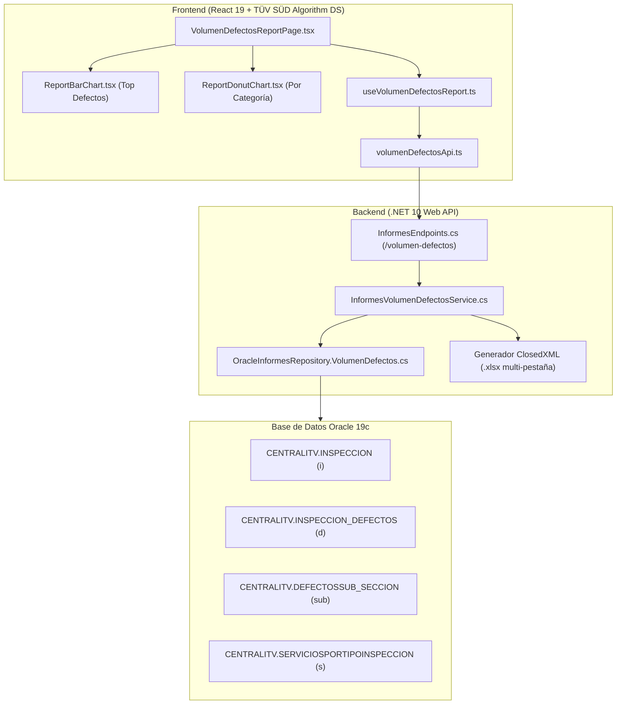

# Módulo de Informe — Volumen de Defectos Detectados (`volumen-defectos` / `defectologia-volumen`)

> **Estado:** Implementado · **Fase:** 2 (Etapa C.7 del Plan de Siguientes Pasos)  
> **Fecha:** 03/11/2026 · **Tecnología:** .NET 10 + React 19 + TypeScript + ClosedXML + Ollama Qwen Coder  
> **Replicación Oficial:** Réplica 1:1 de `frmCriterios.vb` (`ExportacionVolumenDefectosDetectados` / `Cargar_Dataset_Exportacion_VolumenDefectos`).

---

## 1. Propósito de Negocio y Utilidad Analítica

Este informe proporciona un análisis exhaustivo y detallado sobre la **frecuencia, tipología y gravedad de los defectos detectados en inspecciones periódicas** en toda la red de estaciones ITV de TÜV SÜD:
- **Primeras Inspecciones Periódicas**: Filtra exclusivamente inspecciones ordinarias periódicas reglamentarias (`Periodica = 'S'`, `Indica12 = '1'`, `Anulada = 0`), eliminando ruidos de segundas inspecciones y no periódicas.
- **Grupos de Categoría de Vehículo Homologados**: Clasifica automáticamente los vehículos inspeccionados en 7 grupos principales de la directiva europea:
  - `Grupo_M1`: Turismos convencionales y todo-terrenos (M1, M1G).
  - `Grupo_M2_M3`: Autobuses y autocares de transporte de personas (M2, M2G, M3, M3G).
  - `Grupo_N1`: Vehículos comerciales ligeros de transporte de mercancías hasta 3.500 kg (N1, N1G).
  - `Grupo_N2_N3`: Camiones pesados y cabezas tractoras de más de 3,5 t (N2, N2G, N3, N3G).
  - `Grupo_O3_O4`: Remolques y semirremolques pesados (O3, O4).
  - `Grupo_L1_L1e`: Ciclomotores de dos y tres ruedas.
  - `Grupo_L3_L3e`: Motocicletas y triciclos de media/alta cilindrada.
- **Jerarquía Oficial de Defectología ITV**: Desglosa cada defecto en `Bloque` (Capítulo del manual: Frenos, Alumbrado, Emisiones...), `Defecto` (Elemento), `Subdefecto` y `Gravedad` (`L` Leve, `G` Grave, `MG` Muy Grave) cruzado con la descripción oficial en castellano de `CENTRALITV.DEFECTOSSUB_SECCION`.

---

## 2. Diagnóstico de Cuellos de Botella del Legacy y Optimización en Oracle 19c

```mermaid
flowchart TD
    subgraph Legacy["Legacy frmCriterios.vb (Lento y Bloqueante)"]
        L1["Bucle cliente por estación (N ejecuciones consecutivas)"] --> L2["Función PL/SQL CENTRALITV.Periodica(...) fila a fila"]
        L2 --> L3["Subconsultas anidadas con join de 7 columnas repetidas"]
        L3 --> L4["Concatenación de texto SQL (Hard Parsing en SGA)"]
    end

    subgraph Modern["Modernización Web (.NET 10 + Oracle 19c)"]
        M1["1 Consulta única parametrizada para toda la red / selección"] --> M2["INNER JOIN relacional a SERVICIOSPORTIPOINSPECCION (0 PL/SQL)"]
        M2 --> M3["Preagregación relacional y catálogo DEFECTOSSUB_SECCION"]
        M3 --> M4["Plan de ejecución compilado y cacheado con Bind Variables"]
    end
```

| Aspecto | Legacy (`frmCriterios.vb`) | Modernización Web (`ObtenerInformeVclDefectos.sql`) | Ganancia / Impacto |
| :--- | :--- | :--- | :--- |
| **Evaluación de Inspección Periódica** | Función PL/SQL escalar `CENTRALITV.Periodica(Codsepiva, Codestacion) = 'S'` evaluada fila a fila sobre millones de registros en `INSPECCION`. | `INNER JOIN CENTRALITV.SERVICIOSPORTIPOINSPECCION s ON s.CodSepiva = i.CodSepiva AND s.CodEstacion = i.CodEstacion AND s.CodServicio = '01'`. | **> 90% reducción de CPU**. 0 llamadas PL/SQL y uso óptimo de índices B-Tree en Oracle 19c. |
| **Múltiples Estaciones** | Ejecutaba $N$ consultas independientes en bucle (una por cada estación marcada en el grid). | 1 única consulta agregada para todo el lote de estaciones mediante filtro `IN (...)`. | Se reducen los viajes de red (roundtrips) de $N$ a 1. |
| **Párseo y Memoria** | Concatenaba cadenas de texto provocando *Hard Parsing* continuo en Oracle. | Externalizado con *Bind Variables* (:FechaInicio, :FechaFin, :Bloque, :Defecto). | Reutilización de planes de ejecución en el *SGA Shared Pool*. |
| **Inyección de Descripciones** | Repetía las cadenas de descripción en cada fila de inspección antes de agrupar. | Agregación previa de claves y cruce final con `DEFECTOSSUB_SECCION`. | Consumo de memoria temporal de base de datos reducido de gigabytes a megabytes. |

---

## 3. Arquitectura de la Solución

---

## 4. Características de la Interfaz Web y Enlace F5

1. **Ruta y Persistencia F5**:
   * URL de acceso directo: `#/modulo/defectologia-volumen` (o alias `#/modulo/volumen-defectos`).
   * Integración con `sessionStorage` (`cd_active_item` = `'defectologia-volumen'`) para conservar la pantalla intacta ante recargas (F5).
   * Tarjeta dedicada en el catálogo de informes (`InformesHubPage.tsx`) con estado **Disponible** e insignia verde.
2. **Combos en Cascada (Bloque y Defecto)**:
   * Selector dinámico de **Bloque (Capítulo)**: Carga los bloques oficiales desde `CENTRALITV.DEFECTOSBLOQUES`.
   * Selector dinámico de **Elemento / Defecto**: Carga los defectos específicos del bloque elegido desde `CENTRALITV.DEFECTOS`.
   * Admite la opción `-- Todos los Bloques --` y `-- Todos los Elementos --` para análisis globales.
3. **4 KPIs Ejecutivos Interactivos**:
   * **Total Defectos Detectados**: Sumatorio total con badge corporativo.
   * **Defectos con Rechazo (G + MG)**: Defectos Graves y Muy Graves con porcentaje sobre el total y filtro interactivo hacia el grid.
   * **Categoría de Vehículo Líder**: Grupo de vehículos con mayor volumen de defectos (ej. `Turismos (M1): 58.4%`).
   * **Defecto Más Frecuente**: Código tipificado del defecto top detectado.
4. **Visualización Gráfica Dual**:
   * **Ranking por Estación (Barras)**: Gráfico de barras horizontales con scroll vertical continuo y colores de sociedad oficiales: **Azul (`#0046ad`)** para TÜV SÜD ATISAE (TSA) y **Verde (`#00875a`)** para TÜV SÜD CAL (CAL), 100% alineado con la leyenda y sin colores naranja discordantes.
   * **Reparto por Categoría de Vehículo (Donut)**: Gráfico circular interactivo con cuota de mercado por grupo de categoría.
5. **Exportación Oficial a Excel**:
   * Pestaña `TOTAL_DEFECTOS_CONSOLIDADO` (menos de 31 caracteres).
   * Pestañas individuales por cada estación seleccionada `VOLUMEN_DEFECTOS_{CodEstacion}`.
   * Totales calculados numéricos sin fórmulas `=SUM(...)`, evitando errores `#¿NOMBRE?`.

---

## 6. Resolución de Incidencias Oracle 19c Durante la Validación

1. **ORA-00904 (`"D"."CODSECCION": identificador no válido`)**:
   * *Causa*: La tabla relacional `CENTRALITV.INSPECCION_DEFECTOS` no posee la columna `CodSeccion`.
   * *Solución*: Se ajustó el `INNER JOIN` para vincular estrictamente por `CodEstacion` y `CodInspeccion`.
2. **ORA-00979 (`no es una expresión GROUP BY`)**:
   * *Causa*: En el `SELECT` se evaluaban funciones escalares sobre campos descriptivos (`NVL(e.DesEstacion, ...)`, `NVL(TRIM(e.Cod_Empresa), ...)` y `NVL(sub.Descripcion, ...)`), mientras que el `GROUP BY` contenía nombres de columna simples o expresiones incompletas.
   * *Solución Canónica*: Se envolvieron los campos descriptivos con `MAX(e.DesEstacion)`, `MAX(TRIM(e.Cod_Empresa))` y `MAX(sub.Descripcion)` en el `SELECT`, reduciendo el `GROUP BY` exclusivamente a las claves dimensionales de negocio (`CodEstacion`, `GrupoCategoria`, `Bloque`, `Defecto`, `Subdefecto`, `Gravedad`). Esto garantiza compatibilidad 100% estricta en Oracle 19c y máxima velocidad con Hash Group By.

---

## 7. Homologación de KPIs, Tooltips y Búsqueda Inteligente en el Grid

1. **Gráfico de Barras Fiel a la Leyenda de Sociedades**:
   * Representa el volumen de defectos por estación.
   * Colores: **Azul corporativo (`#0046ad`)** para TSA y **Verde (`#00875a`)** para CAL. Eliminado el color naranja en este gráfico.
2. **Comportamiento Homologado de KPIs al Clic**:
   * `Total Defectos Detectados`: Restablece de inmediato los filtros del buscador y muestra todas las filas.
   * `Defectos con Rechazo (G + MG)`: Filtra exclusivamente defectos con gravedad `G` o `MG`.
   * `Categoría de Vehículo Líder`: Filtra por el código de grupo correspondiente (ej. `M1`) con soporte bidireccional de términos (`turismos`, `camiones`...).
   * `Defecto Más Frecuente`: Filtra directamente por el código tipificado de defecto en el grid.
3. **Buscador Inteligente**:
   * Reconoce gravedad precisa (`g`, `grave`, `mg`, `muy grave`, `l`, `leve`, `rechazo`) sin confundirse con letras internas de palabras de descripciones.
4. **Tooltips Descriptivos (AppTooltip)**:
   * Se incorporaron tooltips corporativos en las columnas `Grupo Cat.`, `Cód. Defecto` y `Gravedad` para que el usuario conozca la definición completa reglamentaria sin sobrecargar la interfaz.

---

## 8. Paginación Oficial y Auditoría de Registros (Web vs App de Escritorio)

1. **Scroll Vertical y Barra de Paginación (`ReportPaginationBar`)**:
   * Se integró contenedor con `maxHeight: '620px'`, scroll vertical suave y cabecera de tabla fija (`sticky`, `top: 0`, `zIndex: 3`).
   * Barra de paginación completa con selector de tamaño de página: **50, 100, 200, 500 y 1000 registros**, permitiendo visualizar los 542 defectos en una única vista continua o navegar por páginas.
2. **Comportamiento en la App de Escritorio (`frmCriterios.vb`) vs Central Datos Web**:
   * **En la App Desktop (`frmCriterios.vb`)**:
     * La app legacy **no disponía de pestaña consolidada**.
     * Ejecutaba un bucle por cada estación seleccionada en el grid (`If vntRegistro(2) = "X"`) y generaba exclusivamente hojas individuales: `VOLUMEN_DEFECTOS_{CodEstacion}`.
   * **En la Modernización Web**:
     * **Pestaña `TOTAL_ESTACIONES_SELECCIONADAS`**: Consolida los 542 registros agregados de todas las estaciones seleccionadas en la consulta (30 caracteres).
     * **Pestañas `VOLUMEN_DEFECTOS_{CodEstacion}`**: Desglosan individualmente los defectos pertenecientes a cada estación. La suma de las filas de todas las pestañas por estación coincide con el consolidado total.
3. **Inclusión de Todas las Estaciones Seleccionadas en el Gráfico con Scroll**:
   * El gráfico de barras ahora representa **la totalidad de las estaciones seleccionadas en los filtros** (las 30 estaciones oficiales de la red ITV o el subconjunto marcado).
   * Las estaciones con defectos se ordenan de mayor a menor volumen, y las estaciones con 0 incidencias se sitúan en la parte inferior manteniendo su color de sociedad (**Azul TSA** / **Verde CAL**).
   * Se incluye un scroll vertical continuo estilizado (`maxHeight: 360px`, `scrollbar-color: #0046ad #f1f5f9`) para que el usuario pueda desplazarse y consultar cada centro de la red sin cortes visuales.

