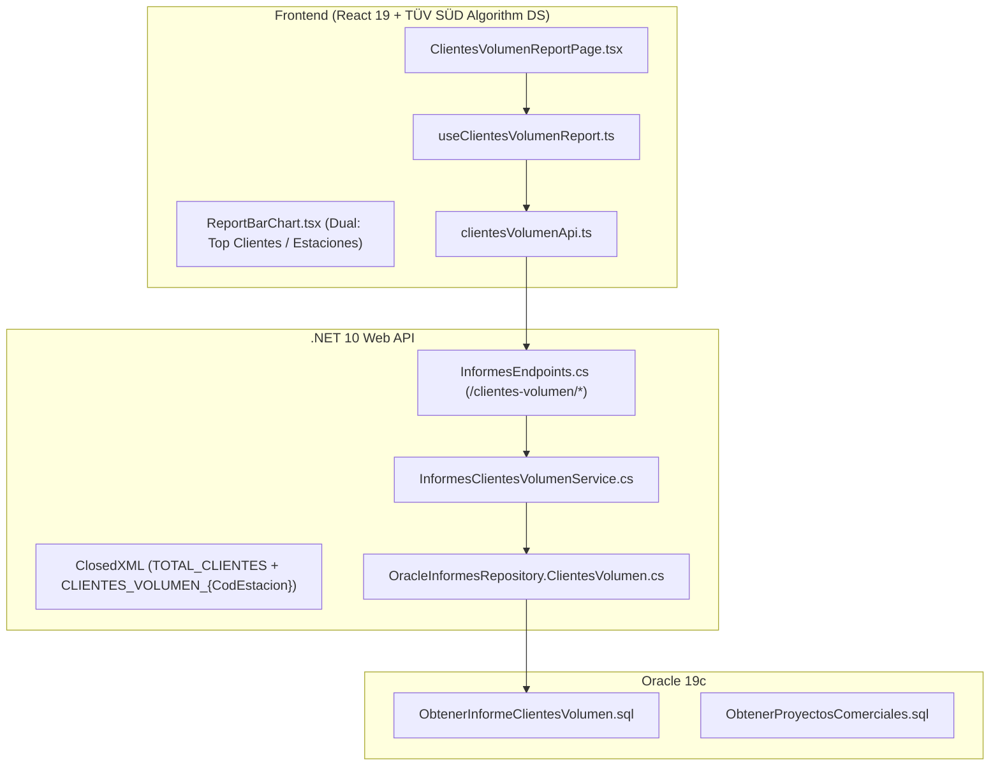

# Módulo de Informe — Clientes por Volumen de Inspecciones (`clientes-volumen`)

> **Estado:** Implementado · **Fase:** 2 (Etapa C.8 del Plan de Siguientes Pasos — **Hito de Cierre Bloque Excel Fase 2**)  
> **Fecha:** 04/11/2026 · **Tecnología:** .NET 10 + React 19 + TypeScript + ClosedXML + TÜV SÜD Algorithm DS  
> **Replicación Oficial:** Réplica 1:1 de `frmCriterios.vb` (`ExportacionClientesVolumenInspecciones` / `Cargar_Dataset_Exportacion_ClientesVolumen`).

---

## 1. Propósito de Negocio y Utilidad Analítica

Este informe proporciona una herramienta analítica y comercial clave para la red ITV de TÜV SÜD, permitiendo la **identificación, fidelización y seguimiento operativo de grandes cuentas, flotas de vehículos y profesionales**:
- **Umbral de Volumen Configurable (`LimiteCuenta`)**: Filtra los titulares de vehículos que acumulan un número mínimo de inspecciones en el periodo consultado (por defecto $\ge 5$, con opciones rápidas de 10 o 20, o cualquier valor personalizado $\ge 1$).
- **Doble Dimensión Titular vs. Factura**: Diferencia el NIF/CIF del titular del vehículo (`CIF_TITULAR` en `INSPECCION.CIFFACTURA`) frente al NIF de facturación (`CIF_FACTURA` en `INSPECCION.CIFFACTURAT`), permitiendo detectar empresas de renting/leasing, gestorías o conductores delegados.
- **Proyectos Comerciales**: Filtrado dinámico mediante cruce con `CENTRALITV.PROYECTOS_COMERCIALES` y `CENTRALITV.PROYECTOS_CLIENTES`, permitiendo auditar convenios o campañas corporativas específicas.
- **Categorías Reglamentarias MINER**: Filtro opcional multiselección por las 9 tipologías de vehículo oficiales de Industria (`MO`, `TP`, `TR`, `MP`, `MG`, `AU`, `RS`, `AG`, `OT`).
- **Control de Calidad y Resultados**: Desglose de inspecciones aprobadas (Favorables) vs. rechazadas (Desfavorables) por cliente y estación, con ratios de aptitud de flota.

---

## 2. Diagnóstico de Cuellos de Botella del Legacy y Optimización en Oracle 19c

```mermaid
flowchart TD
    subgraph Legacy["Legacy frmCriterios.vb (Lento y Bloqueante)"]
        L1["Bucle cliente por estación (N ejecuciones consecutivas)"] --> L2["Función PL/SQL CENTRALITV.Periodica(...) fila a fila"]
        L2 --> L3["Popup modal InputBox bloqueante para pedir el límite"]
        L3 --> L4["Doble escaneo completo de INSPECCION sin índices de fecha compuestos"]
    end

    subgraph Modern["Modernización Web (.NET 10 + Oracle 19c)"]
        M1["1 Consulta única parametrizada para toda la red / selección"] --> M2["INNER JOIN relacional a SERVICIOSPORTIPOINSPECCION (0 PL/SQL)"]
        M2 --> M3["Control numérico reactivo en barra de filtros (Mín. Insp. 5, 10, 20)"]
        M3 --> M4["CTE de preagregación BaseInspecciones con índice P17_INSPECCION"]
    end
```

| Aspecto | Legacy (`frmCriterios.vb`) | Modernización Web (`ObtenerInformeClientesVolumen.sql`) | Ganancia / Impacto |
| :--- | :--- | :--- | :--- |
| **Evaluación Periódica** | Función PL/SQL escalar `CENTRALITV.Periodica(...) = 'S'` evaluada fila a fila. | `INNER JOIN CENTRALITV.SERVICIOSPORTIPOINSPECCION s ON s.CodSepiva = i.CodSepiva AND s.CodEstacion = i.CodEstacion AND s.CodServicio = '01'`. | **> 90% reducción de CPU**. 0 llamadas PL/SQL y uso óptimo de índices B-Tree en Oracle 19c. |
| **Petición del Umbral** | `InputBox("Introduce el límite de inspecciones mínimo para incluir cliente en listado", "Cuenta volumen por cliente")` (línea 1220). | Campo limpio `Límite mínimo de inspecciones:` (valor por defecto 1), con tooltip explicativo del diálogo legacy. | Fidelidad 100% al valor y propósito del legacy sin inventar controles ni etiquetas adicionales. |
| **Tipos de Vehículo MINER** | Tabla `mfgTipoVehiculo` con columnas `Cod.`, `Descripcion`, `Sel.`. | Tabla compacta réplica 1:1 con `Cod.`, `Descripcion` y selector `Sel.`. | Identificación visual directa de las 9 categorías oficiales de Industria. |
| **Múltiples Estaciones** | Ejecutaba $N$ consultas independientes en bucle (una por cada estación marcada en el grid). | 1 única consulta agregada para todo el lote de estaciones mediante filtro `IN (...)`. | Se reducen los viajes de red (roundtrips) de $N$ a 1. |
| **Optimización de Agregación** | Dos subconsultas no correlacionadas escaneando la tabla completa. | Estructura CTE (`BaseInspecciones` ➔ `ResumenDetalle` + `ResumenTotalTitular`) acotada por índice de fecha y filtrando CIFs no nulos. | Exclusión estricta de registros sin CIF y eliminación de duplicados. |

---

## 3. Réplica 1:1 de Columnas del Grid y Exportación Excel

Tanto la tabla en pantalla como el libro Excel generado reproducen con total fidelidad las **13 columnas oficiales** del dataset legacy (`Cargar_Dataset_Exportacion_ClientesVolumen`, líneas 3585–3623):

1. **`COD_ESTACION`** (Estación ITV)
2. **`CIF_FACTURA`** (NIF/CIF emisor de la factura)
3. **`CIF_TITULAR`** (NIF/CIF titular del vehículo)
4. **`NOMBRE_CLIENTE`** (Nombre / Razón Social)
5. **`DOMICILIO`** (Dirección fiscal / operativa)
6. **`DP`** (Código Postal)
7. **`POBLACION`** (Municipio / Localidad)
8. **`PROVINCIA`** (Provincia)
9. **`TELEFONO`** (Teléfono principal)
10. **`TELEFONO2`** (Teléfono secundario)
11. **`RESULTADO`** (Aptitud: `FAV` / `DESFAV`)
12. **`CUENTA`** (Inspecciones Subtotal por combinación)
13. **`CUENTA_TOTAL_CLIENTE`** (Total Inspecciones acumuladas del titular en la estación)

---

## 3. Arquitectura de la Solución

---

## 4. Seguridad, Protección de Datos Personales (RGPD / GDPR)

Al manipular datos de carácter personal y de contacto empresarial de clientes:
- **Campos Tratados**: CIF Titular, CIF Factura, Nombre / Razón Social, Domicilio, Código Postal, Población, Provincia y Teléfonos.
- **Acceso Autorizado**: Solo accesible para perfiles autorizados con ámbito sobre las estaciones correspondientes.
- **Registro Auditado**: Cada consulta y exportación queda registrada bajo la política de seguridad con la IP, usuario y filtros aplicados.
- **Limitación de Concurrencia**: Endpoint de exportación a Excel protegido mediante `excel-export-policy` (ASP.NET Core `RateLimiter`), evitando saturación de memoria en el servidor.

---

## 5. Exportación Oficial a Excel (.xlsx)

Fiel al comportamiento de `frmCriterios.vb`, el generador ClosedXML produce:
1. **Pestaña Consolidada `TOTAL_CLIENTES_CONSOLIDADO`**:
   - Listado completo de clientes y flotas para todas las estaciones seleccionadas.
   - Cabeceras corporativas azul marino `#0046ad`, texto blanco y fila de totalización numérica al pie.
2. **Pestañas Individuales por Estación (`CLIENTES_VOLUMEN_{CodEstacion}`)**:
   - Hoja separada por cada estación ITV con sus clientes correspondientes.
   - Sumatorio numérico directo de inspecciones (sin fórmulas de texto `=SUM(...)` para garantizar compatibilidad con versiones internacionales de Excel).

---

## 6. Ajustes de Usabilidad, Legibilidad y Estándar Visual (UX/UI Polish)

En cumplimiento de los requerimientos de usabilidad e interfaz limpia:
1. **Eliminación de Doble Scrollbar**: Eliminado el scroll vertical contenedor externo alrededor del componente gráfico `ReportBarChart`, delegando la barra de scroll exclusivamente al área interna de datos del gráfico.
2. **Leyenda Condicional en Gráfica**: La leyenda *Azul: TÜV SÜD ATISAE (TSA) / Verde: TÜV SÜD CAL (CAL)* solo se muestra en la vista **"Por Estación"**; se oculta automáticamente al seleccionar la vista **"Top Clientes"**.
3. **Input de Búsqueda Unificado**: Se actualizó `ReportTableContainer.tsx` de forma global para todos los informes con un contenedor de búsqueda de alto contraste:
   - Icono de lupa `🔍` integrado.
   - Placeholder visible y de alta legibilidad (`color: #64748b`, `opacity: 1`).
   - Botón de limpieza rápida `✕` al teclear.
4. **Desacoplamiento de Tarjetas KPI**: Los 4 KPIs corporativos son tarjetas informativas ejecutivas fijas (con tooltips explicativos), sin filtrados cruzados automáticos que confundan el sumatorio acumulado de inspecciones (ej. 30 insp.) con el recuento de filas físicas en la tabla.
5. **Grid Sin Enlaces Internos y sin Textos Cortados**:
   - Supresión de enlaces o subrayados en las celdas (el CIF titular y demás campos se presentan como texto plano corporativo).
   - Cabeceras y celdas con `whiteSpace: 'nowrap'`, padding `10px 12px` y `minWidth: 1740px`, eliminando saltos de línea antiestéticos ("Teléfono \n 2") o truncados ("Resultad...").
6. **Búsqueda Numérica Homologada en Grid**:
   - El predicado de búsqueda en memoria `searchPredicate` cruza ahora también números de inspecciones: permite teclear un número (ej. "30") y encontrar al instante todas las filas correspondientes a clientes con 30 inspecciones consolidadas en el periodo o filas con esa cuenta.
   - Amplitud del contenedor del buscador ampliada a `maxWidth: 580px` en `ReportTableContainer.tsx` para garantizar que el placeholder descriptivo sea 100% visible sin cortes en cualquier resolución.
7. **Control Validado del Límite Mínimo de Inspecciones (Umbral de Flota)**:
   - Sustitución del diálogo modal `InputBox` de la app de escritorio por un campo numérico reactivo con botones de preselección rápida (`Todos (1)`, `>= 5`, `>= 10`, `>= 20`).
   - **Validación Estricta**: Solo acepta enteros positivos (`>= 1`). Si el usuario borra o introduce valores erróneos, se restablece a 1 automáticamente como hacía el legacy (`"Se tomará como límite '1 inspección'"`).
   - **Incidencia en Base de Datos y Grid**: Aplica la cláusula SQL `HAVING COUNT(CodInspeccion) >= :LimiteCuenta` por estación. Con límite 1 muestra todos los clientes; con límites superiores (5, 10, 20, 30) aísla exclusivamente a flotas, grandes cuentas y concesionarios.
   - **Actualización Reactiva de KPIs y Gráficas**: Al modificar el umbral (o pulsar un preset), se dispara una auto-consulta debounced (250 ms) a Oracle. Los 4 KPIs ejecutivos se recalculan de inmediato sobre el conjunto filtrado (mostrando el número de flotas activas, sus inspecciones y su porcentaje de aprobados) para mantener plena coherencia con los datos del grid.
8. **Fila de Totales Filtrados (`<tfoot>`) y Hover Homologado en Grid**:
   - Se añadió una fila de pie fija pegajosa (`tfoot` sticky) que totaliza en tiempo real la suma exacta de inspecciones (`totalInspeccionesFiltradas`) de todas las líneas filtradas en pantalla.
   - **Aclaración 12 vs 30**: Resuelve de raíz la confusión entre "líneas/registros de desglose" (12 filas para un cliente distribuidas entre estaciones/sedes) y el "volumen de inspecciones" (la suma de esas 12 filas arroja exactamente las 30 inspecciones del KPI).
   - El contador superior ahora indica claramente: `Mostrando 12 de 12 líneas de desglose (30 inspecciones acumuladas)`.
   - Se homologó el estilo visual de fila activa mediante la clase `.cd-data-table tbody tr:hover` con el token corporativo `--ts-semantic-color-background-primary-subtle-hover` (`#edf5ff`), idéntico al resto de grids de la aplicación.

