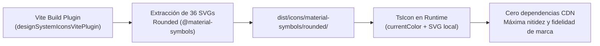

# Guía de Despliegue en Servidor (Iconos DS) y Plan de Informes Restantes

> **Proyecto:** Modernización TÜV SÜD Central Datos Web (`TUV-SUD-CENTRAL-DATOS-WEB`)  
> **Fecha:** Noviembre 2026  
> **Estado:** Completada migración de iconos DS / Planificación técnica de informes pendientes  

---

## 1. Migración Oficial a TÜV SÜD Algorithm Design System Icons

Se ha completado la transición desde emojis Unicode provisionales hacia los iconos vectoriales oficiales de **TÜV SÜD Algorithm Design System** (`@tuvsud/design-system` / `@material-symbols/svg-400/rounded`).



### 1.1. Ventajas de la Solución
* **Fidelidad Institucional:** Cumplimiento estricto de las directrices corporativas de TÜV SÜD.
* **Cero dependencias externas:** Los 36 iconos se sirven directamente desde el bundle estático local (archivos SVG de entre 200 y 800 bytes).
* **Consumo de tokens y rendimiento:** Tamaño total del set empaquetado: **~22 KB sin comprimir (~11 KB gzipped)**.
* **Escalabilidad y accesibilidad:** Renderizado vectorial nativo con escalado SVG sin distorsión y color gobernado por tokens CSS (`currentColor`).

---

## 2. Guía de Despliegue en Servidor de Producción

Para que los iconos vectoriales y las fuentes tipográficas oficiales funcionen correctamente tras compilar (`npm run build`), se deben verificar las siguientes configuraciones en el servidor web de destino:

### 2.1. Despliegue en Microsoft IIS (Windows Server)

En el archivo `web.config` de la aplicación web en IIS, asegurarse de registrar los tipos MIME para archivos `.svg` y `.woff2`:

```xml
<?xml version="1.0" encoding="utf-8"?>
<configuration>
  <system.webServer>
    <staticContent>
      <!-- Asegurar soporte de iconos SVG y fuentes corporativas -->
      <remove fileExtension=".svg" />
      <mimeMap fileExtension=".svg" mimeType="image/svg+xml" />
      <remove fileExtension=".woff2" />
      <mimeMap fileExtension=".woff2" mimeType="font/woff2" />
      <remove fileExtension=".woff" />
      <mimeMap fileExtension=".woff" mimeType="font/woff" />
    </staticContent>

    <!-- Reglas de enrutamiento SPA (React Router) -->
    <rewrite>
      <rules>
        <rule name="React SPA Routing" stopProcessing="true">
          <match url=".*" />
          <conditions logicalGrouping="MatchAll">
            <add input="{REQUEST_FILENAME}" matchType="IsFile" negate="true" />
            <add input="{REQUEST_FILENAME}" matchType="IsDirectory" negate="true" />
            <add input="{REQUEST_URI}" pattern="^/(api)" negate="true" />
          </conditions>
          <action type="Rewrite" url="/" />
        </rule>
      </rules>
    </rewrite>

    <!-- Encabezados de caché para estáticos inmutables -->
    <httpProtocol>
      <customHeaders>
        <add name="X-Content-Type-Options" value="nosniff" />
        <add name="X-Frame-Options" value="SAMEORIGIN" />
      </customHeaders>
    </httpProtocol>
  </system.webServer>
</configuration>
```

### 2.2. Despliegue en Nginx (Linux / Contenedores)

```nginx
server {
    listen 80;
    server_name centraldatos.tuv.es;
    root /var/www/central-datos-web/dist;
    index index.html;

    # Iconos y assets estáticos con compresión gzip y caché inmutable
    location /icons/ {
        expires 1y;
        add_header Cache-Control "public, max-age=31536000, immutable";
        types {
            image/svg+xml svg;
        }
    }

    location /assets/ {
        expires 1y;
        add_header Cache-Control "public, max-age=31536000, immutable";
    }

    # SPA Fallback
    location / {
        try_files $uri $uri/ /index.html;
    }

    # Proxy reverso a la API .NET 8 Kestrel
    location /api/ {
        proxy_pass http://localhost:5113/api/;
        proxy_http_version 1.1;
        proxy_set_header Upgrade $http_upgrade;
        proxy_set_header Connection keep-alive;
        proxy_set_header Host $host;
        proxy_cache_bypass $http_upgrade;
    }
}
```

### 2.3. Despliegue bajo Subruta (Directorio Virtual)
Si la aplicación se aloja en un subdirectorio (ej. `https://intranet.tuvsud.es/central-datos/`):
1. En `vite.config.ts`, definir `base: '/central-datos/'`.
2. En `src/main.tsx`, registrar la ruta base de iconos:
   ```typescript
   registerGoogleMaterial({ basePath: '/central-datos/icons/material-symbols' });
   ```

---

## 3. Estado de Informes y Plan de Acción

### 3.1. Informes Completados (Fases A, B y C - 8 Módulos Core)
| Ref | Módulo de Informe | Legacy VB / SQL | Estado Web |
|---|---|---|:---:|
| **C1** | Favorables y Rechazados | `Favorables_Rechazados` |  Completado (Web + Crystal + ClosedXML) |
| **C2** | Inspecciones con Cupón Descuento | `Inspecciones_Cupon_Descuento` |  Completado |
| **C3** | Facturación e Inspecciones | `Facturacion_Inspecciones` |  Completado |
| **C4** | Defectos y Control OBD | `Inspecciones_Defectos_OBD` |  Completado |
| **C5** | Duración Promedio de Inspección | `Inspecciones_Duracion_Promedio` |  Completado (Web + Crystal 1 Hoja) |
| **C6** | MINER Estadísticas Globales | `Estadistica_MINER_Global` |  Completado (Industria.xls) |
| **C7** | Bastidores OBD No Coincidentes | `Informe_Bastidores_OBD_No_Coincidentes` |  Completado |
| **C8** | Grandes Clientes / Flotas por Volumen | `Clientes_Volumen_Inspecciones` |  Completado |

---

### 3.2. Plan del Informe Faltante: Envíos SMS y Email Recordatorios (`Envios_Sms_Mail`)

Este es el principal informe operativo pendiente del legacy `frmCriterios.vb`.

#### Arquitectura del Informe
* **Origen Legacy:** `frmCriterios.vb:3694` (`Cargar_Dataset_Exportacion_SmsEmailEnviados`).
* **Tablas de Base de Datos:**
  * `CENTRALITV.INSPECCION_SMS` (Envíos vía SMS con identificador `IDTIPO_SMS`).
  * `CENTRALITV.INSPECCION_EMAIL` (Envíos vía Email con identificador `IDTIPO_EMAIL`).
  * `CENTRALITV.TIPO_TEXTO_RECORDATORIO` (Catálogo maestro de plantillas de recordatorio: primera caducidad, aviso previo, segundo aviso, etc.).
  * `CENTRALITV.INSPECCION` (Fecha de caducidad oficial del vehículo).

#### Criterios y Filtros de Búsqueda
1. **Rango de Fechas de Envío (`FECHAENVIO`):** Fecha inicial y final en que se disparó la comunicación.
2. **Rango de Fechas de Caducidad (`FECHACADUCIDAD`):** Fecha teórica de vencimiento de la inspección.
3. **Tipo de Envío:**
   * Solo SMS (`INSPECCION_SMS`).
   * Solo Email (`INSPECCION_EMAIL`).
   * Ambos canales combinados.
4. **Selector de Estaciones:** Multiselección de estaciones asignadas al usuario / sociedad.

#### Estructura de Datos y Agrupación SQL
```sql
SELECT 
    IE.CODESTACION,
    T.IDTIPO,
    T.DESCRIPCION AS PLANTILLA,
    IE.FECHAENVIO,
    I.FECHACADUCIDAD,
    COUNT(*) AS TOTAL_ENVIOS
FROM CENTRALITV.INSPECCION_SMS IE -- O INSPECCION_EMAIL
INNER JOIN CENTRALITV.INSPECCION I 
    ON IE.CODESTACION = I.CODESTACION AND IE.CODINSPECCION = I.CODINSPECCION
INNER JOIN CENTRALITV.TIPO_TEXTO_RECORDATORIO T 
    ON IE.IDTIPO_SMS = T.IDTIPO
WHERE IE.CODESTACION IN (:Estaciones)
  AND IE.FECHAENVIO BETWEEN :FechaEnvioIni AND :FechaEnvioFin
  AND I.FECHACADUCIDAD BETWEEN :FechaCaducidadIni AND :FechaCaducidadFin
GROUP BY IE.CODESTACION, T.IDTIPO, T.DESCRIPCION, IE.FECHAENVIO, I.FECHACADUCIDAD
ORDER BY IE.CODESTACION, IE.FECHAENVIO DESC, T.IDTIPO
```

#### Propuesta de Interfaz Web (Algorithm DS)
1. **Filtros Especializados:** Componente con doble selector de rango de fechas (Envío y Caducidad) y selector segmentado (SMS / Email / Ambos).
2. **Tarjetas KPI:**
   * Total Recordatorios Enviados.
   * Total SMS vs Total Email.
   * Plantilla más utilizada.
   * Estaciones con mayor actividad de recordatorios.
3. **Gráfico Resumen:** Distribución de envíos por tipo de plantilla y canal.
4. **Tabla de Datos y Exportación ClosedXML:** Formato idéntico al legacy con hojas separadas `ENVIOS_SMS` y `ENVIOS_EMAIL`.

---

### 3.3. Otros Módulos Restantes del Legacy
1. **Inspecciones sin Inspector (`Inspecciones_Sin_Inspector`):** Auditoría de inspecciones cerradas sin inspector asignado.
2. **Búsqueda Avanzada de Inspecciones (`frmCriteriosLocalizacion`):** Localización multi-criterio de expedientes por matrícula, bastidor, titular o defectos.
3. **Información ENAC / Calidad ITV:** Informes técnicos específicos de acreditación y calidad reglamentaria.

---

## 4. Próximos Pasos Recomendados

1. **Aprobación de la Especificación de SMS/Email:** Confirmar los requerimientos de la pantalla de envíos recordatorios.
2. **Implementación Backend del Endpoint:** Crear `EnviosRecordatoriosController.cs` y servicio Oracle con Dapper en .NET 8.
3. **Construcción Frontend del Módulo:** Vista `EnviosRecordatoriosPage.tsx` con componentes nativos de Algorithm DS y exportación Excel.
