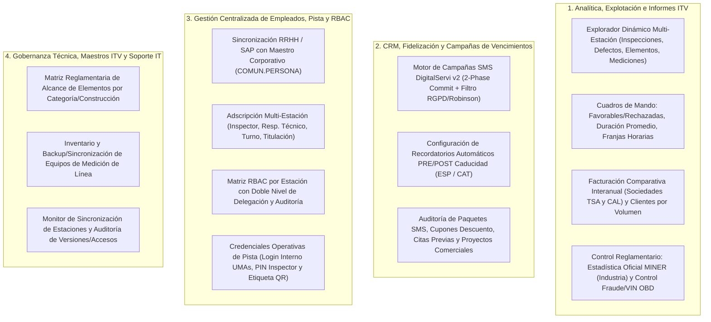
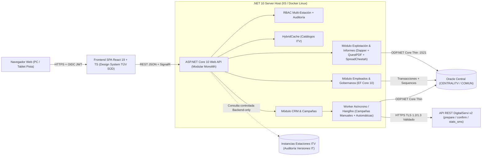

# Análisis de Producto, Arquitectura Web y Estrategia de Modernización — Central Datos (TÜV SÜD)

> [!IMPORTANT]
> **Principio rector de la modernización:** Conservar y potenciar el **concepto funcional de negocio** de *Central Datos* (explotación analítica multi-estación ITV, informes regulatorios y de facturación, campañas CRM/SMS de vencimientos y gestión centralizada de empleados/permisos de pista), **erradicando al 100% sus artefactos técnicos heredados**: clases cursor/grid propias (`clsCur`, `clsGrd/GrX/GrE`), transporte SQL crudo sobre SOAP (`centralitv.asmx`), `SAP Crystal Reports`, `Interop.Excel` / `ACE.OLEDB` y bases locales `Access .mdb` de 32 bits.

---

## 1. Radiografía Real del Producto Actual

### 1.1. Métricas Reales del Código: Alcance Vivo vs. Código Muerto (Ahorro inmediato del ~45%)

El repositorio SVN (`https://svn.tuv-sud.es/repo/desarrol/AP_GESITV/trunk/ITV-CENTRAL_DATOS`, rev. `71995`) aparenta contener **104.991 líneas** en 147 ficheros, pero la auditoría forense de [Central_Datos.vbproj](file:///c:/Project/ITV-CENTRAL_DATOS/Central_Datos/Central_Datos.vbproj) demuestra que una parte sustancial no debe migrarse:

| Categoría en el Repositorio | Archivos `.vb` / `.rpt` | Líneas (LOC) | Diagnóstico para la Nueva Web |
| :--- | :---: | :---: | :--- |
| **Código Huérfano No Compilado (`r51686`)** | 44 `.vb` | 36.192 | **DESCARTAR (0% a migrar).** Restos del *fork* inicial desde la app local de estación `GESITV` (22/01/2021): tarifas locales, cabinas, líneas, contratos locales, `modDigitalServi.vb` v1 y prototipos. |
| **Código Auto-generado (`.Designer.vb` XSD / SOAP)** | 14 `.vb` | ~11.800 | **DESCARTAR.** DataSets tipados de Crystal Reports y proxies ASMX (`CentralITV_Svc`, `Login_Svc`). |
| **Framework Legacy WinForms (`clsCur`, `clsGr*`, `clsCbo`, `clsTbr`)** | 12 `.vb` | 8.746 | **ERRADICAR.** Sustituido por .NET 10 Data Access (Dapper + EF Core) y componentes Web modernos. |
| **Módulos Compilados pero Muertos / Obsoletos** | 4 `.vb` + 5 `.rpt` | ~2.100 | **DESCARTAR.** `frmLogin_Obsoleto.vb`, `modSMS.vb` y `modRGPD.vb` (antiguo proveedor Ignium), `clsPrc.vb` (roto bajo modo Web) y 5 de los 9 informes `.rpt` (huérfanos o solo usados como test de arranque). |
| **Núcleo Funcional Activo de Negocio** | **31 `.vb` + 4 `.rpt`** | **~46.150** | **CONCEPTO DE NEGOCIO A MODERNIZAR** (con fuerte consolidación: 4 pantallas clonadas de localización de ~9.400 líneas se unifican en 1 solo motor). |

---

### 1.2. Mapa Funcional del Producto (Los 4 Dominios de Valor de Negocio)

Al abstraer los formularios WinForms ([mdiMain.vb](file:///c:/Project/ITV-CENTRAL_DATOS/Central_Datos/Formularios/mdiMain.vb)), el producto resuelve **cuatro dominios de negocio** sobre el esquema centralizado Oracle `CENTRALITV` y el maestro corporativo `COMUN.PERSONA`:



#### Detalle de lo que debe sustituirse conceptualmente por dominio:
1. **Explotación e Informes ([frmCriterios.vb](file:///c:/Project/ITV-CENTRAL_DATOS/Central_Datos/Formularios/frmCriterios.vb), [frmCriteriosExcel.vb](file:///c:/Project/ITV-CENTRAL_DATOS/Central_Datos/Formularios/frmCriteriosExcel.vb), `frmCriteriosLocalizacion*.vb`):**
   - Hoy existen **4 pantallas casi idénticas** ([frmCriteriosLocalizacion.vb](file:///c:/Project/ITV-CENTRAL_DATOS/Central_Datos/Formularios/frmCriteriosLocalizacion.vb), `Defectos`, `Elementos`, `Mediciones`) dirigidas por tablas de metadatos (`CAMPOS_*LOCALIZADOS`) y un formulario camaleónico de 4.416 líneas (`frmCriterios.vb`) con 12 informes activos.
   - **De los 9 ficheros Crystal Reports (`Informes\rpt*.rpt`), solo 4 están activos en producción:**
     1. `rptInspFavorablesRechazadas.rpt` → pasa a vista Web analítica + exportación PDF (**QuestPDF**) / Excel.
     2. `rptResumenInspecciones.rpt` (Facturación contable Contado/Terceros/Tarjeta/Gratuitas) → pasa a vista Web + PDF/Excel.
     3. `rptDuracionPromedio.rpt` (Tiempos en pista por tipo de vehículo) → pasa a Dashboard KPI + PDF/Excel.
     4. `rptEtiqueta.rpt` (Etiqueta QR de empleado) → pasa a componente SVG/Canvas imprimible desde navegador + PDF directo.
   - Los informes Excel con plantilla física (`Plantilla Informe de facturación.xlsx` en [clsExcelFacturacion.vb](file:///c:/Project/ITV-CENTRAL_DATOS/Central_Datos/Clases/clsExcelFacturacion.vb) con 34 estaciones fijas de TSA/CAL, e `Industria.xls` para MINER) deben generarse **dinámicamente en servidor con OpenXML**, leyendo las estaciones activas desde BD para no quedar obsoletos al abrir una nueva ITV.

2. **CRM y Campañas SMS DigitalServi v2 ([frmEnvioRecordatorios.vb](file:///c:/Project/ITV-CENTRAL_DATOS/Central_Datos/Formularios/frmEnvioRecordatorios.vb), [modDigitalServi_v2.vb](file:///c:/Project/ITV-CENTRAL_DATOS/Central_Datos/Modulos/modDigitalServi_v2.vb)):**
   - Selecciona vehículos cuya ITV periódica va a caducar (sin inspección posterior y con consentimiento), genera plantillas bilingües (Castellano/Catalán) con variables dinámicas (`` `$var1` ``..`` `$landing` ``) y ejecuta lotes de 200 SMS mediante un protocolo de 2 fases (`check_sms` → `prepare_sms` con validación RGPD/Lista Robinson → `confirm_sms` / `cancel_sms`).
   - En la nueva Web debe pasar de bloquear la interfaz durante 10 minutos (`Timeout = 600.000 ms`) a ejecutarse en un **Worker asíncrono en segundo plano**, incorporando además el endpoint `stats_sms` (ya soportado por DigitalServi pero hoy desaprovechado en la UI) para visualizar tasas reales de entrega y clics en `` `$landing` ``.

3. **RRHH, Adscripción a Centros y Credenciales de Pista ([mdiEmpleados_General.vb](file:///c:/Project/ITV-CENTRAL_DATOS/Central_Datos/Formularios/mdiEmpleados_General.vb), [frmPermisosEmpleado.vb](file:///c:/Project/ITV-CENTRAL_DATOS/Central_Datos/Formularios/frmPermisosEmpleado.vb)):**
   - Vincula empleados desde `COMUN.PERSONA`, gestiona a qué estaciones están asignados (`EMPLEADO_CENTRO`: inspector, responsable técnico, puesto, turno, titulación), administra permisos delegados por estación (`EMPLEADO_PERMISOS` + auditoría en `LOG_PERMISOS_USUARIO`) y emite credenciales locales de pista (`Usuario_Login_Interno`, `PIN_Inspector` de 4 dígitos y etiqueta QR), notificando cambios a las estaciones mediante `CENTRALITV.SYS_SINCRONIZACION` (`GrabarFechaModificacion`).

4. **Gobernanza ITV y Soporte IT ([frmAlcanceElementos.vb](file:///c:/Project/ITV-CENTRAL_DATOS/Central_Datos/Formularios/frmAlcanceElementos.vb), [frmConfiguracionMediciones.vb](file:///c:/Project/ITV-CENTRAL_DATOS/Central_Datos/Formularios/frmConfiguracionMediciones.vb), [FrmInformesVersion.vb](file:///c:/Project/ITV-CENTRAL_DATOS/Central_Datos/Formularios/FrmInformesVersion.vb)):**
   - Parametriza el alcance reglamentario de puntos de inspección por categoría/construcción (completando el CRUD hoy incompleto que solo permite `INSERT` sin edición ni baja), reactiva en Web el gestor de backup de ficheros de calibración de máquinas de línea (`frmConfiguracionMediciones`, hoy oculto en menú) y centraliza en backend la consulta de versiones y accesos de estaciones.

---

### 1.3. Problemas Arquitectónicos Críticos y Bugs Activos que Justifican el Rediseño

> [!WARNING]
> La aplicación actual presenta **antipatrones bloqueantes de seguridad y escalabilidad** que hacen inviable una simple conversión automática ("lift & shift") de WinForms a Web:

1. **Antipatrón *SQL-over-SOAP* sin sesión ([clsCur.vb](file:///c:/Project/ITV-CENTRAL_DATOS/Central_Datos/Clases/clsCur.vb) + [centralitv.wsdl](file:///c:/Project/ITV-CENTRAL_DATOS/Central_Datos/Web%20References/CentralITV_Svc/centralitv.wsdl)):** El cliente concatena SQL crudo en el PC del usuario y lo envía a `https://gestion.atisae.com/centralitvwebservice/centralitv.asmx` (`GetDatos_3` / `ExecuteSQL_3`) autenticado únicamente con un MD5 sobre la semilla estática `"HELKFN23AJURJSK2D"`. Cualquier cliente con acceso a la URL y la semilla puede ejecutar SQL arbitrario sobre Oracle.
2. **Falsa parametrización y *Hard Parsing* masivo en Oracle:** Aunque el código usa `?` y `oCur.Param()`, `clsCur.TransSQL` no crea `OracleParameter`; sustituye `?` por literales de texto (usando `¬` como comodín intermedio, corrompiendo textos con `¬`). Oracle no reutiliza planes de ejecución y queda expuesto a **Inyección SQL** (incluso pre-autenticación en `frmLogin.vb:451`).
3. **Exposición de credenciales de todas las estaciones ITV y anulación de SSL:** `FrmInformesVersion.vb` descarga al PC cliente las cadenas de conexión Oracle completas (`CONNECTION_STRING` con usuario/clave) de todas las estaciones desde `CENTRALITV.INSTANCIAS_BBDD`. Además, `modMain.vb`, `modRGPD.vb` y `modDigitalServi_v2.vb` fuerzan `ServerCertificateValidationCallback = Return True`, desactivando globalmente la verificación TLS/HTTPS.
4. **Bloqueos en Servidor Web (`Interop.Excel`, `ACE.OLEDB`, `Crystal Reports`, `x86`):** Automatizar `EXCEL.EXE` en servidor provoca *deadlocks* en *Session 0* y fugas de procesos (~35 instancias COM por exportación multi-estación); `ACE.OLEDB` escribe exportaciones ejecutando **1 `INSERT` por fila sin transacción**; y el proceso `x86` (32 bits) colapsa por memoria al deserializar `DataSet`s XML gigantes.
5. **Bugs funcionales activos hoy en producción (que corregiremos en la nueva capa de dominio):**
   - **Corrupción silenciosa en Excel de Facturación** ([clsExcelFacturacion.vb](file:///c:/Project/ITV-CENTRAL_DATOS/Central_Datos/Clases/clsExcelFacturacion.vb#L18-L72)): el array `ingresosInspecciones` no se reinicia entre iteraciones del bucle de estaciones; si una ITV no tuvo actividad en uno de los años comparados, hereda la facturación de la estación anterior. Tampoco funciona si se comparan dos periodos del mismo año.
   - **Cruce de columnas SAP al insertar empleados** ([mdiEmpleados_General.vb](file:///c:/Project/ITV-CENTRAL_DATOS/Central_Datos/Formularios/mdiEmpleados_General.vb#L1005-L1007)): guarda `Centro_SAP` en `Usuario_SAP`, `Organizacion_SAP` en `Centro_SAP` y `Usuario_SAP` en `Organizacion_SAP`.
   - **Condición duplicada `If bMail Then`** ([frmCriterios.vb](file:///c:/Project/ITV-CENTRAL_DATOS/Central_Datos/Formularios/frmCriterios.vb#L2339-L2365)): impide exportar solo SMS en el informe de envíos totales.
   - **Pérdida de días de desfase en envíos automáticos** ([frmConfigEnviosRecordatorioAuto.vb](file:///c:/Project/ITV-CENTRAL_DATOS/Central_Datos/Formularios/frmConfigEnviosRecordatorioAuto.vb#L724-L742)): el `UPDATE` omite `NUM_DIAS_DESFASE_FILTRO`.
   - **Sobrescritura cruzada de flags de Backup/Restore** ([frmConfiguracionMediciones.vb](file:///c:/Project/ITV-CENTRAL_DATOS/Central_Datos/Formularios/frmConfiguracionMediciones.vb#L1773-L1782)): lee los checkboxes de la pestaña 2 al guardar en la pestaña 3.
   - **Error sintáctico SQL `@ON`** en histórico de Citas Previas ([frmBusqueda_General.vb](file:///c:/Project/ITV-CENTRAL_DATOS/Central_Datos/Formularios/frmBusqueda_General.vb#L465)), riesgo `ORA-01791` en `SELECT DISTINCT` de mediciones, rechazo ilegal de NIEs con letra `Z` en [modID.vb](file:///c:/Project/ITV-CENTRAL_DATOS/Central_Datos/Modulos/modID.vb#L1159-L1177) y generación de PKs sin secuencias (`SELECT MAX(ID)+1`) sin transacciones.

---

## 2. Selección del Mejor Stack Tecnológico

Partiendo de tu orientación hacia **.NET** y del software ya instalado en tu estación de trabajo (**.NET 10 SDK `10.0.402` LTS**, **Visual Studio Professional 2026**, **Node.js `v24.18.0`** y **Git `2.56`**), hemos evaluado las tres arquitecturas candidatas más sólidas para aplicaciones corporativas intensivas en datos sobre Oracle:

### 2.1. Comparativa de Alternativas

| Criterio | **Opción A (RECOMENDADA): .NET 10 Web API + React 19 (TypeScript)** | **Opción B: .NET 10 Blazor Web App (Interactive Server/WASM)** | **Opción C: Node.js (NestJS) o Java (Spring Boot) + SPA** |
| :--- | :--- | :--- | :--- |
| **Rendimiento en Rejillas Masivas (50k+ filas, 48 cols)** | **Sobresaliente.** `TanStack Table v8` + virtualización de filas/columnas a 60 fps en navegador sin latencia de red por clic. | **Medio.** *Blazor Server* sufre latencia SignalR y consumo RAM por circuito en rejillas pesadas; *WASM* tiene carga inicial mayor. | **Sobresaliente** en frontend, pero menor aprovechamiento del ecosistema actual del equipo. |
| **Alineación con Equipo y Ecosistema GesITV (.NET / C#)** | **Máxima** en backend C# (.NET 10 LTS hasta nov. 2028) + ecosistema React estándar en industria y herramientas IA. | **Máxima** para equipos 100% C# que no deseen mantener proyecto TypeScript separado. | **Baja.** Obliga a cambiar de lenguaje backend respecto al resto de soluciones `.NET` de la casa. |
| **Conectividad Oracle Corporativa** | **`Oracle.ManagedDataAccess.Core` (Modo Thin 100% C#)**: sin instalar Oracle Client, pooling nativo de alto rendimiento. | Igual que Opción A en el servidor. | `node-oracledb` Thin / JDBC: maduros, pero sin ventaja frente a ODP.NET Core. |
| **Desacoplamiento / Escalabilidad Futura** | **API REST OpenAPI pura**: reutilizable por futuros portales, BI, apps móviles de pista o microservicios. | Acopla estado de UI al servidor (en modo Server) salvo que se construya igualmente una Web API intermedia. | API REST pura, pero duplica stack tecnológico en la organización. |

> [!TIP]
> **Recomendación definitiva:** **Arquitectura Modular Monolith (Clean Architecture / Vertical Slices) con Backend ASP.NET Core 10 (C# 14) + Frontend SPA React 19 + TypeScript + Vite**. *(Nota: Si el equipo de desarrollo prefiere evitar TypeScript al 100% en una primera etapa, **Blazor Web App en .NET 10 con MudBlazor/FluentUI** sobre la misma capa de Aplicación C# es una alternativa válida, pero React + TanStack Table ofrece una experiencia muy superior para el explorador analítico multi-columna de inspecciones).*

---

### 2.2. Stack Tecnológico Completo Pieza a Pieza (Sustitución 1:1 de Legado)

| Capa | Tecnología Legacy (A Eliminar) | Tecnología Nueva Recomendada (.NET 10) | Beneficio Directo |
| :--- | :--- | :--- | :--- |
| **Backend & Fin del Puente SOAP/OCI** | WinForms `.exe` x86 en estaciones + puente `centralitv.asmx` (por falta de visibilidad OCI/`:1521` en estaciones) | **ASP.NET Core 10 Web API (`CentralDatos.Api`)** alojada en el servidor central (IIS 64-bit / Linux) | Al ser Web centralizada, las estaciones solo usan navegador HTTPS `:443` y el backend conecta **directo** a Oracle sin `centralitv.asmx` ni `OCI`. |
| **Driver Oracle** | `System.Data.OracleClient` + SOAP XML | **`Oracle.ManagedDataAccess.Core` v23+ (Modo Thin)** | Conexión TCP/TLS directa desde el servidor IIS/API a Oracle **sin instalar Oracle Instant Client**. |
| **Acceso a Datos (Adiós `clsCur`)** | `clsCur`, `clsPrc`, `modID.DaQ` (strings concatenados) | **Híbrido Dapper + EF Core 10**: **Dapper** para queries analíticas dinámicas con *Bind Variables* (`:p0`); **EF Core 10** para CRUD transaccional | **0% SQL Injection**, *Soft Parsing* en Oracle, transacciones reales (`UnitOfWork`) y mapeo tipado. |
| **Informes PDF (Adiós Crystal)** | `SAP Crystal Reports v13` (`9 .rpt` + Flash ActiveX) | **QuestPDF** (C# fluido en backend) + **`TsQrCode` / `QRCoder`** (SVG nativo para etiquetas) | Genera los 4 PDFs reales en `< 100 ms`, multiplataforma, versionable en Git y sin runtime en clientes. |
| **Motor Excel (Adiós Interop)** | `Interop.Excel` COM + `ACE.OLEDB` (`INSERT` fila a fila) | **SpreadCheetah / MiniExcel** (streaming masivo) + **ClosedXML** (plantillas formateadas TSA/CAL y MINER) | Exporta **100.000 filas en ~1,5 s** con `< 25 MB` de RAM en *streaming* HTTP directo, sin Office instalado. |
| **Trabajos en Fondo & Tiempo Real** | Hilo UI bloqueado 10 min + Tarea externa aislada | **Hangfire** (o Worker Service + Quartz) + **SignalR / SSE** | Unifica envíos SMS manuales y el demonio automático `ENVIOS_CLIENTE_CONFIG_AUTO`, con progreso en vivo. |
| **Caché y Rendimiento** | Recarga repetitiva de combos por SOAP | **`.NET 10 HybridCache`** (Memoria L1 + Redis opcional L2) | Cachea catálogos (`ESTACIONES`, `SEPIVA`, `DEFECTOS`, `CATEGORIAS`) reduciendo un ~70% las lecturas repetitivas. |
| **Identidad y Seguridad** | `Login.asmx` + `chkSSO` inseguro + claves en claro | **Evolución de `Login_Svc` a Auth API (LDAPS / Entra ID OIDC -> JWT + Refresh Cookie `HttpOnly`)** + **RBAC Policy-based** por Estación | Sesión firmada verificada en cada petición, elevación de supervisor con `TsOtpInput` auditada (`Actor` + `Subject`) y secretos protegidos en servidor. |
| **Frontend & Estética Oficial TÜV SÜD** | `System.Windows.Forms.DataGrid` (.NET 1.1) | **React 19 + TypeScript + `@tuvsud/design-system` (TÜV SÜD Algorithm Design System) + TanStack Table/Query + Apache ECharts** | Estándar oficial de `create.tuvsud.com` (84 componentes `Ts*`, fuente `TUV SUD Pro`, tokens `--ts-semantic-*`) combinado con virtualización tabular de alta densidad. |
| **Observabilidad** | `log.txt` plano en `%APPDATA%` con datos RGPD | **OpenTelemetry + Serilog** (con enmascaramiento PII/RGPD) | Trazabilidad completa de tiempos SQL, llamadas a DigitalServi y auditoría de negocio sin filtrar DNIs a ficheros. |

---

### 2.3. Arquitectura Objetivo de la Nueva Plataforma Web



---

## 3. Sistema de Diseño Web Oficial: TÜV SÜD Algorithm Design System (`create.tuvsud.com`)

> [!NOTE]
> Se dispone tanto del prototipo navegable **`tuv_sud_central_datos_prototipo.html`** como del estándar técnico completo en **`estandar_tuv_sud_algorithm_design_system.md`** y el Skill de Antigravity **`tuv-sud-algorithm-ds`**, extraídos directamente de la documentación oficial de [create.tuvsud.com](https://create.tuvsud.com/).

Para alinear *Central Datos* con el estándar global **TÜV SÜD Algorithm Design System** (`@tuvsud/design-system` sobre Web Components + wrappers oficiales React en `@tuvsud/design-system/react`), el frontend adopta sus tokens semánticos, utilidades modulares `ts-*` y catálogo de 84 componentes:

1. **Identidad Cromática y Temas Oficiales (`.ts-theme-light` / `.ts-theme-dark`):**
   - **TÜV SÜD Brand Blue (`--ts-semantic-color-surface-brand-blue`):** `#0046ad` (hover `#003687`) para acciones primarias, indicadores activos y acentos del octágono corporativo.
   - **Inverted Navy (`--ts-semantic-color-surface-inverted-default`):** `#0b253b` para cabecera superior corporativa, navegación lateral (`TsSidebar`) y alto contraste.
   - **Superficies Semánticas:** `--ts-semantic-color-surface-default` (`#ffffff`), `--ts-semantic-color-surface-subtle` (`#f4f6f9`), `--ts-semantic-color-border-default` (`#d0dae5`).
   - **Semántica Reglamentaria ITV (`TsBadge` / `TsTag` / `TsAlert`):**
     - *Favorable / Estación Online / SMS Confirmado:* `--ts-semantic-color-status-success` (`#0f7b3f`).
     - *Favorable con Defectos Leves / Desfase Sync / Bloqueo RGPD:* `--ts-semantic-color-status-warning` (`#b45309`).
     - *Desfavorable / Negativa / Alerta Fraude VIN OBD / PIN Bloqueado:* `--ts-semantic-color-status-danger` (`#c81e1e`).
2. **Tipografía Oficial, Componentes Nativos ITV y Densidad Tabular:**
   - Fuente corporativa **`'TUV SUD Pro', system-ui, sans-serif`** (`@tuvsud/design-system/theme/fonts.css`) combinada con `font-variant-numeric: tabular-nums` y fuente monoespaciada para **matrículas, bastidores VIN de 17 caracteres, códigos SEPIVA, importes contables y paquetes SMS**.
   - Aprovechamiento directo de componentes oficiales que reemplazan librerías legacy: **`TsQrCode`** (sustituye `ThoughtWorks.QRCode` + `rptEtiqueta.rpt`), **`TsOtpInput`** (sustituye el diálogo WinForms de `PIN_Inspector` de 4 dígitos), **`TsDateRangePicker`** (localización nativa `es-ES` `DD/MM/YYYY`), **`TsTable` + `TsPagination`** (y `TanStack Table` virtualizado con tokens `--ts-semantic-*` para exploraciones de 50k+ filas).
3. **Mejoras Clave de Experiencia de Usuario (UX) frente a la app actual:**
   - **Vistas y Filtros Guardados ("Presets"):** Los analistas podrán guardar combinaciones frecuentes de filtros (ej. *"Rechazos OBD Cataluña Último Mes"*) y compartirlas por enlace URL.
   - **Previsualización Instantánea antes de Exportar:** Todas las consultas mostrarán primero una vista paginada rápida en pantalla (< 200 ms) con totales agregados antes de descargar el `.xlsx` o `.pdf`, evitando exportar a ciegas ficheros erróneos.
   - **Centro de Descargas Asíncrono (`TsToast` + Campana de Notificaciones):** Si un usuario solicita exportar 300.000 mediciones, puede seguir trabajando en otras pantallas mientras el backend genera el `.xlsx` y le avisa con un clic de descarga cuando termina.

---

## 4. Análisis de Desarrollo y Estrategia de Migración (*Strangler Fig*)

### 4.1. Reglas de Coexistencia sin Corte de Servicio con Estaciones ITV (`GESITV`)

La ventaja estratégica de este proyecto es que **la base de datos Oracle `CENTRALITV` y `COMUN.PERSONA` actúa como punto de integración estable**. La nueva aplicación Web y el actual `Central_Datos.exe` pueden **coexistir en paralelo** para distintos grupos de usuarios siguiendo tres reglas de compatibilidad:

1. **Respetar el contrato de replicación a estaciones (`SYS_SINCRONIZACION`):** Cada vez que la nueva Web modifique `EMPLEADO`, `EMPLEADO_CENTRO` o `ELEMENTOS_CATEGORIA`, el repositorio C# actualizará `CENTRALITV.SYS_SINCRONIZACION.Fecha_Modificacion = SYSDATE` exactamente igual que hacía `GrabarFechaModificacion`, para que las 34 estaciones ITV descarguen los cambios de forma transparente.
2. **Compatibilidad criptográfica dual temporal en Pista:** Mientras las aplicaciones locales de pista (`ITV-PLANTA` / `ITV-CABINA`) sigan validando `PIN_Inspector` y `Pass_Interno` con `SHA-256` sin sal sobre `CENTRALITV.EMPLEADO`, el módulo Web de Empleados seguirá escribiendo el hash compatible en esa columna (corrigiendo el tope artificial de 10 caracteres y bloqueando PINs descendentes `4321`), preparando una columna adicional `Pass_Hash_V2` (`Argon2id` / `PBKDF2`) para cuando se actualice planta.
3. **Eliminación progresiva de `SELECT MAX(ID) + 1`:** Crear `SEQUENCE`s reales en Oracle sincronizadas con el `MAX(ID)` actual (o encapsular la obtención de ID) una vez retirado la escritura desde el cliente legado en cada módulo.

---

### 4.2. Hoja de Ruta Incremental por Fases y Estimación Orientativa

Estimación calculada para un equipo ágil de **2 desarrolladores Full-Stack .NET + apoyo puntual de DBA Oracle** (~5 a 6 meses en total, con **valor en producción desde el Mes 2**):

| Fase | Duración Est. | Alcance y Entregables | Hito de Negocio / Retirada de Legado |
| :--- | :---: | :--- | :--- |
| **Fase 0: Cimientos, Entorno Dev y Seguridad** | **2–3 semanas** | Solución `.NET 10` + React + Vite + Design System TÜV SÜD; conexión `ODP.NET Thin` a Oracle Desa; autenticación Entra ID / AD + motor RBAC multi-estación (`EMPLEADO_PERMISOS`); CI/CD y contenedor/IIS de Desarrollo. | Login SSO real, selector de estaciones permitidas y menú corporativo operativo en entorno Dev. |
| **Fase 1: Quick Wins — Monitorización, Dashboards y Facturación** | **4–5 semanas** | Dashboard de sincronización (`frmUltimaInspeccion` en 1 query), los 3 informes PDF activos en **QuestPDF** (Favorables/Rechazadas, Facturación Contable, Duración Promedio), Comparativa Excel Facturación TSA/CAL dinámica (**ClosedXML**, corrigiendo el bug de arrastre de importes) y Estadística MINER. | **Primer lanzamiento a Dirección / Control de Gestión.** Se elimina la dependencia de *Crystal Reports* en puestos de gerencia. |
| **Fase 2: Motor Unificado de Exploración ITV & OBD** | **5–6 semanas** | Unificación de `frmCriteriosLocalizacion` (Inspecciones, Defectos, Elementos, Mediciones) + informes Excel de `frmCriterios` (Defectos OBD, Bastidores VIN OBD no coincidentes, Sin Inspector, Rango Horario, Cupones, Clientes por Volumen) con *Bind Variables*, paginación *Keyset* y exportación *streaming* **SpreadCheetah**. | **Mayor salto de rendimiento y escalabilidad.** Consultas de minutos pasan a segundos sin bloqueos ni fugas de `EXCEL.EXE`. |
| **Fase 3: Gestión de Empleados, RBAC, Pista y Gobernanza ITV** | **4 semanas** | Módulo RRHH sincronizado con `COMUN.PERSONA` (corrigiendo cruce SAP), adscripción `EMPLEADO_CENTRO`, matriz de permisos auditada (`LOG_PERMISOS_USUARIO`), gestión PIN/Usuario Interno + **Etiqueta QR SVG/PDF nativa**, CRUD completo de `Alcance Elementos` y reactivación de `Equipos Mediciones` + `Informes Versiones IT` desde backend seguro. | Retirada total de `ThoughtWorks.QRCode`, `Crystal Reports` (`rptEtiqueta`) y cierre del agujero de `INSTANCIAS_BBDD` hacia clientes. |
| **Fase 4: Orquestador Asíncrono CRM & Campañas SMS DigitalServi** | **4 semanas** | Migración de `frmEnvioRecordatorios`, `frmConfigEnviosRecordatorioAuto` y `frmVisualizarPaquetesSMS` a **Hangfire / Worker .NET 10** con `HttpClient` TLS validado, unificando el demonio automático externo, importación/exportación Excel de campañas, métricas `stats_sms`, Proyectos Comerciales y Citas Previas. | Unificación completa de Marketing/CRM en un único motor trazable 24/7. |
| **Fase 5: Apagado del Legado (*Decommission*)** | **2 semanas** | Paralelo final de validación (UAT), bloqueo de acceso en `SYS_CONFIGURACION_CENTRAL`, **apagado definitivo de `centralitv.asmx` y `Login.asmx`**, y desinstalación del MSI `Central_Datos.exe` / servicio `SW_Actualizador`. | **Cierre total del vector SQL-over-SOAP** y coste cero de mantenimiento de escritorio. |

---

## 5. Puesta en Marcha del Entorno de Desarrollo Local

Tu equipo ya cuenta con las herramientas ideales instaladas (**`.NET SDK 10.0.402`**, **`Visual Studio Professional 2026 v18.11`**, **`Node.js v24.18.0`** y **`Git 2.56.0`**; *Docker no está instalado, y con ODP.NET Thin tampoco es obligatorio si conectas contra la instancia Oracle de Desarrollo `DESA` por VPN*).

### 5.1. Estructura del Entorno PoC Aislado Ya Creado (`c:\Project\TUV-SUD-CENTRAL-DATOS-WEB`)

Se ha inicializado un repositorio **Git** limpio en `c:\Project\TUV-SUD-CENTRAL-DATOS-WEB` (manteniendo `c:\Project\ITV-CENTRAL_DATOS` en SVN 100 % intacto y separado) con arquitectura limpia de **Monolito Modular (.NET 10)**:

```text
TUV-SUD-CENTRAL-DATOS-WEB/
├── .agents/skills/tuv-sud-algorithm-ds/  # Skill oficial TÜV SÜD Algorithm Design System versionado en el workspace
├── src/
│   ├── CentralDatos.Api/                 # ASP.NET Core 10 Web API (/api/v1/*, CORS, OpenAPI, coexistencia IIS)
│   ├── CentralDatos.Application/         # Casos de uso (CQRS ligero), DTOs, Validadores (FluentValidation)
│   ├── CentralDatos.Domain/              # Entidades (Inspeccion, Empleado, PaqueteSms), Reglas ITV, Permisos
│   ├── CentralDatos.Infrastructure/      # ODP.NET Thin (Dapper + EF Core 10), QuestPDF, SpreadCheetah/ClosedXML, DigitalServi
│   └── central-datos-web/                # Frontend React 19 + TypeScript + Vite + @tuvsud/design-system (.npmrc.example)
├── tools/
│   └── central-datos-mcp/                # Servidor MCP de Base de Datos (Solo Lectura, transporte dual SOAP + Oracle Thin)
├── AGENTS.md                             # Reglas automáticas del workspace (sincronización documental, no auto-commit)
└── TuvSud.CentralDatos.sln               # Solución .NET 10 compilando con 0 errores y 0 advertencias
```

### 5.2. Configuración Segura de Entornos (Sin Recompilar Nunca Más)

1. **Perfiles estándar de ASP.NET Core 10:**
   - `appsettings.json`: parámetros no sensibles (tamaños de página, límites de lote SMS `200`, timeouts HTTP).
   - `appsettings.Development.json`: URLs de entorno de pruebas de DigitalServi (*sandbox* / modo *Dry-Run* que simula `prepare_sms` y `confirm_sms` sin enviar SMS reales a clientes durante el desarrollo) y conexión a Oracle `DESA`.
   - **Secretos locales fuera del código:** Usar `dotnet user-secrets` en Visual Studio 2026 para la cadena de conexión Oracle (`Data Source=(DESCRIPTION=...);User Id=...;Password=...;`), eliminando para siempre credenciales en código o tablas planas.
2. **Modo *Dry-Run* obligatorio en Desarrollo para integraciones externas:**
   - Implementar la interfaz `IDigitalServiClient` con dos adaptadores: `DigitalServiHttpClient` (Producción/Preproducción) y `SandboxDigitalServiClient` (Desarrollo local, que registra los payloads JSON en consola/BD sin disparar SMS reales ni consumir saldo).

### 5.3. Servidor MCP de Base de Datos (`central-datos-db`) Configurado en Antigravity

> [!TIP]
> El servidor MCP **`central-datos-db`** ya está implementado, instalado y registrado en [`mcp_config.json`](file:///C:/Users/Usuario/.gemini/config/mcp_config.json) apuntando a [`tools/central-datos-mcp/index.mjs`](file:///c:/Project/TUV-SUD-CENTRAL-DATOS-WEB/tools/central-datos-mcp/index.mjs). Consulta el detalle completo de uso y herramientas en `guia_entorno_poc_y_mcp_base_datos.md`.

Soporta **transporte dual de solo lectura** (máximo 200 filas por consulta, bloqueando cualquier DML/DDL/PLSQL):
- **`DB_MODE = "soap"` (por defecto, cero configuración Oracle local):** Conecta por HTTPS `:443` a `CENTRALITV_WS_URL` (`https://gestion-desa.atisae.com/centralitvwebservice/centralitv.asmx`).
- **`DB_MODE = "oracle"` (conexión directa `:1521`):** Utiliza `node-oracledb` v6 en modo *Thin* puro (`SET TRANSACTION READ ONLY`) definiendo `ORACLE_CONNECT_STRING`, `ORACLE_USER` y `ORACLE_PASSWORD` sin requerir instalar *Oracle Instant Client*.
