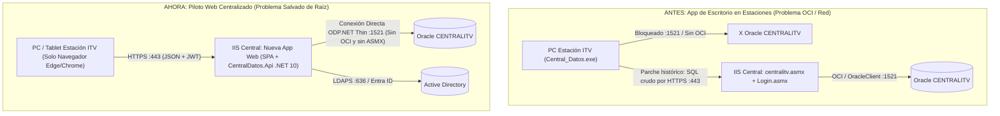

# Impacto del Paso a Web sobre los Web Services (`CentralITV_Svc` y `Login_Svc`)

> [!IMPORTANT]
> **Conclusión Arquitectónica Clave**: Tu planteamiento es **100 % exacto**. `centralitv.asmx` (`CentralITV_Svc`) existía únicamente como "puente" porque `Central_Datos.exe` era una **aplicación de escritorio** ejecutándose localmente en los PCs de las estaciones ITV, los cuales no tenían visibilidad de red (`:1521`) ni cliente Oracle (`OCI`) contra la base de datos central (`CENTRALITV`). **Al pasar a una aplicación Web alojada en el servidor central, ese problema queda resuelto de raíz**: no necesitamos ningún Web Service intermedio de base de datos ni instalar `OCI` en ningún puesto.

---

## 1. Por Qué `centralitv.asmx` Deja de Ser Necesario en el Piloto Web

### 1.1. Antes (Escritorio WinForms en Estaciones) vs. Ahora (Aplicación Web Centralizada)

Al ejecutarse el backend de la nueva aplicación Web (**`CentralDatos.Api` en ASP.NET Core 10**) directamente en el servidor central (la misma zona de red donde hoy reside `gestion-desa.atisae.com` / `gestion.atisae.com`):

1. **Visibilidad de Base de Datos Resuelta**: Quien abre la conexión a Oracle `CENTRALITV` (`:1521`) ya **no es la estación ITV**, sino el propio servidor Web central, que ya tiene visibilidad directa con la base de datos. Las estaciones ITV solo necesitan abrir su navegador por **HTTPS (`:443`)**.
2. **Adiós Definitivo a `OCI` (`oci.dll` / Oracle Client) en Estaciones y en Servidor**:
   - En las **estaciones ITV**: 0 instalaciones, 0 drivers de 32/64 bits, 0 ficheros `tnsnames.ora`.
   - En el **servidor Web `.NET 10`**: Usamos `Oracle.ManagedDataAccess.Core` en **Modo Thin (100 % C# gestionado)**, que habla el protocolo TTC de Oracle directamente por TCP/TLS **sin depender siquiera de `oci.dll` ni de Oracle Instant Client en el servidor**.
3. **Eliminación de un Salto Innecesario (*Zero Double-Hop*)**:
   - La nueva Web **no tiene que llamar a `centralitv.asmx` ni necesitamos crear un "nuevo Web Service envoltorio de BBDD"** separado de la propia API del proyecto Web.
   - `CentralDatos.Api` (el backend REST de la SPA React) consulta Oracle directamente con *Connection Pooling* nativo y *Bind Variables* (`:p0`), ahorrando la serialización SOAP XML/`DataSet` y reduciendo la latencia un **80–90 %**.

---

## 2. Qué Hacer Entonces con `centralitv.asmx` y `Login.asmx`

Dado que el piloto Web **no necesita consumirlos**, la estrategia se simplifica drásticamente y elimina riesgos sobre producción:

| Servicio Legacy | ¿Necesita modificarse para el Piloto Web? | Rol durante el Piloto y Coexistencia | Destino Final |
| :--- | :---: | :--- | :--- |
| **`centralitv.asmx`** (`CentralITV_Svc`) | **NO** | Se mantiene intacto en su App Pool `.NET Framework 4.x` actual únicamente para dar servicio a `Central_Datos.exe` (y posibles módulos hermanos como `ITV-GERENCIA` o `ITV-CONTABILIDAD`) mientras convivan. | **Apagado (*Decommission*)** cuando se retire el `.exe` (tras verificar en logs de IIS que ningún otro ejecutable desktop lo invoca). |
| **`Login.asmx`** (`Login_Svc`) | **NO** | Sigue atendiendo el login de las aplicaciones WinForms legacy sin riesgo de regresión. La nueva Web autentica directamente desde `CentralDatos.Api` contra Active Directory (LDAPS) o Microsoft Entra ID (SSO) emitiendo tokens **JWT + Cookie `HttpOnly`**. | **Sustituido en Web** por `/api/v1/auth/*` (o SSO corporativo Entra ID). |

> [!TIP]
> **Ventaja para el Piloto**: No tocar `centralitv.asmx` ni `Login.asmx` significa **riesgo cero** de romper aplicaciones de escritorio en estaciones durante toda la fase de desarrollo y validación del piloto Web.

---

## 3. Los Dos Únicos Casos Donde Hay que Tener Cuidado con la Red

Aunque la conexión a `CENTRALITV` queda resuelta al estar el servidor Web en el centro de datos, existen **dos escenarios puntuales** contemplados en nuestra arquitectura:

### 3.1. Consultas desde Central hacia las BBDD Locales de Cada Estación (`INSTANCIAS_BBDD`)
- En el código legacy (`FrmInformesVersion.vb`), el `.exe` descargaba la tabla `CENTRALITV.INSTANCIAS_BBDD` (con las cadenas de conexión de cada estación ITV) e intentaba conectarse por Oracle desde el PC del usuario a cada estación.
- **En la nueva Web**: Ese sondeo lo ejecuta también **el backend `CentralDatos.Api` desde el servidor central** (en paralelo con `Parallel.ForEachAsync` y *timeout* corto de 3–4 s por estación), devolviendo al navegador solo el JSON con las versiones/estados. Basta con verificar que la VLAN del servidor Web tenga permiso hacia el `:1521` de las estaciones (igual que hoy para sincronización) y **las credenciales de las estaciones jamás viajan al navegador**.

### 3.2. Desarrollo Local desde tu Portátil / Puesto de Trabajo (Servidor MCP y Entorno Dev)
- Cuando la aplicación Web esté desplegada en el servidor (`gestion-desa`), hablará **directo por `:1521`** con Oracle `DESA` / `PROD`.
- Sin embargo, mientras programas en **localhost** desde tu equipo (o cuando Antigravity usa el servidor MCP `central-datos-db` para inspeccionar tablas e índices):
  - **Si tu VPN de desarrollo sí ve el puerto `:1521` de Oracle `DESA`**: tanto `CentralDatos.Api` en local como el MCP usan **conexión directa Oracle Thin (`DB_MODE=oracle`)**.
  - **Si tu puesto local no tiene abierto el `:1521` hacia Oracle pero sí llega por HTTPS `:443` a `gestion-desa.atisae.com`**: el servidor MCP `central-datos-db` incluye el modo `DB_MODE=soap` exclusivamente como **comodín de desarrollo** para poder leer el diccionario de datos (`ALL_TAB_COLUMNS`, `ALL_INDEXES`) sin bloquearte por firewall, mientras que la aplicación Web real jamás usará SOAP.

---

## 4. Resumen de Cómo Queda la Arquitectura Limpia del Piloto Web

| Aspecto | App Escritorio Legacy (`Central_Datos.exe`) | Nuevo Piloto Web (`TUV-SUD-CENTRAL-DATOS-WEB`) |
| :--- | :--- | :--- |
| **Despliegue en Estaciones ITV** | Instalador MSI + actualizador + dependencias locales x86 | **Cero instalación** (acceso vía navegador HTTPS `:443`) |
| **Dependencia de `OCI` (`oci.dll`)** | Requerida en modo directo / en servidor ASMX | **Eliminada al 100 %** (`ODP.NET Thin` puro en servidor `.NET 10`) |
| **Paso por `centralitv.asmx` (SOAP)** | Obligatorio desde estaciones (`GetDatos_Paginados_3` / `ExecuteSQL_3`) | **Eliminado al 100 %** (`CentralDatos.Api` conecta directo a Oracle `:1521`) |
| **Seguridad de Consultas** | SQL concatenado en cliente + semilla MD5 estática | Endpoints REST de negocio (`/api/v1/*`) + *Bind Variables* `:p0` + JWT RBAC |
| **Despliegue en IIS Central** | App Pool `.NET Framework 4.x` (`centralitv.asmx`) | App Pool independiente **`.NET 10` (`No Managed Code`, 64-bit)** sirviendo la SPA React + `/api/v1/*` |
